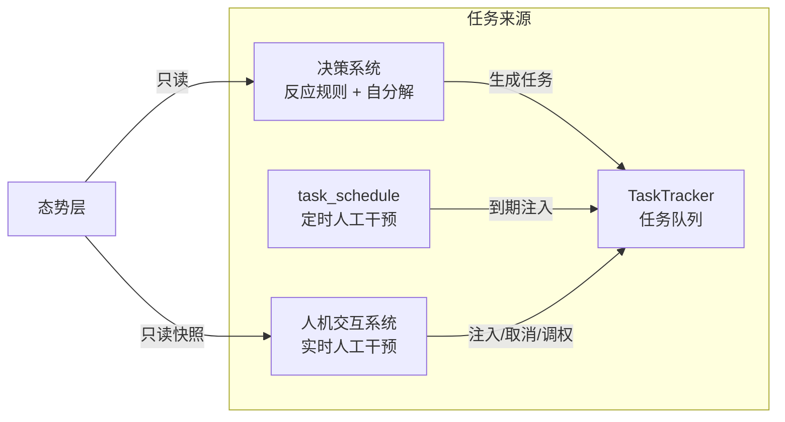
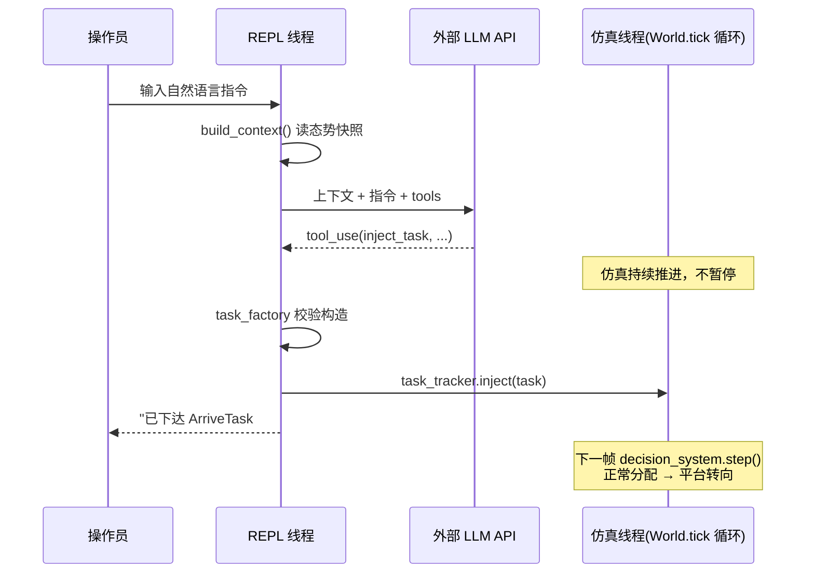

# 人机交互与指令系统设计

## 1. 概述

人机交互系统（HCI 层）为指控系统提供**运行时人工干预通道**。操作员通过终端（一期）或 Web 界面（二期）下达指令，系统将其转化为对 TaskTracker 的任务操作。

在总体架构中，任务共有三个来源，本系统实现其中的**实时人工干预**（另两个为决策系统反应规则、场景 `task_schedule` 定时注入）：



### 核心职责

| 职责 | 说明 |
| :--- | :--- |
| **指令接收** | 终端 REPL 读取操作员输入（斜杠命令 / 自然语言） |
| **指令翻译** | 通过外部 LLM API（function calling）将自然语言转为结构化任务操作 |
| **任务操作** | 调用 TaskTracker 公开接口执行注入 / 取消 / 调整优先级 |
| **态势呈现** | 从态势层生成任务列表、平台状态、已发现目标的文本快照，供操作员与 LLM 共同参考 |

### 核心设计原则

**HCI 层与决策系统平级，是任务的生产者而非管理者；对仿真核心零侵入。**

1. **零侵入** — 全部功能以新增 `interaction/` 模块实现，仿真核心（World / TaskTracker / DecisionSystem / SituationManager）不修改任何一行代码，`main.py` 仅新增一个启动参数。交互功能关闭时系统行为与原版完全一致。
2. **只走公开接口** — 三个任务操作全部通过 TaskTracker 已有的人工调用接口（`inject` / `cancel` / `reprioritize`）完成，不直接修改 `task.status`、`assigned_platform_ids`、`platform.current_task`（遵守黄金法则）。
3. **态势查询不碰真值** — 操作员"看到的世界"与指控系统一致：目标信息来自态势层快照，不读取 `world.entities` 真值（遵守 AGENTS.md 反模式 2/7 约束）。
4. **执行复用现有链路** — 人工注入的任务是普通 PENDING 任务，由决策系统在下一帧按优先级正常分配；高优先级指令的抢占由现有分配器机制自动完成，HCI 层不实现任何调度逻辑。


## 2. 架构

```mermaid
graph TD
    subgraph HCI 层（新增 interaction/ 模块）
        UI[repl.py<br/>终端交互线程]
        LLM[llm_client.py<br/>function calling 循环]
        TF[task_factory.py<br/>参数校验 + Task 构造]
        EX[executor.py<br/>三操作统一封装]
        CB[context_builder.py<br/>态势快照]
    end

    subgraph 仿真核心（零修改）
        W[World]
        TC[TaskTracker]
        SA[SituationManager]
    end

    UI -->|斜杠命令| EX
    UI -->|自然语言| LLM
    LLM -->|tool_use 参数| TF
    TF --> EX
    CB -->|上下文文本| LLM
    EX -->|inject / cancel / reprioritize| TC
    CB -->|只读| SA
    CB -->|只读| TC
```

### 模块划分

| 模块 | 职责 |
| :--- | :--- |
| `repl.py` | 独立 daemon 线程运行输入循环；按前缀分发：`/` 开头走结构化通道，其余走自然语言通道 |
| `executor.py` | 三个任务操作的统一封装，含参数合法性判断与结果文本格式化。**斜杠命令与 LLM 通道共用同一实现** |
| `context_builder.py` | 从 `task_tracker` 与 `situation` 生成紧凑文本快照 |
| `task_factory.py` | 将 LLM 返回的 `(task_type, params)` 校验并构造为 Task 实例 |
| `llm_client.py` | 外部 API 封装与 function calling 主循环 |

### 允许 / 禁止操作速查

延续 AGENTS.md 层职责边界表，HCI 层的边界如下：

| 允许 | 禁止 |
| :--- | :--- |
| 调用 `task_tracker.inject()` / `cancel()` / `reprioritize()`；构造 Task 实例；读取 `situation` 全部查询接口；读取 `task_tracker.get_active()` / `get_all()` | 修改 `task.status` / `assigned_platform_ids` / `platform.current_task`；访问 `world.entities` 真值；调用分配器或分解器；修改仿真核心任何代码 |


## 3. 指令通道设计

采用**双通道**：结构化操作（参数即 ID 与数字）直达 executor，无需也不应经过 LLM；需要语义理解的指令（方位换算、目标指代、任务类型选择）走 LLM。

### 3.1 结构化通道（斜杠命令）

| 命令 | 说明 |
| :--- | :--- |
| `/list` | 显示当前 pending + active 任务（ID、类型、状态、优先级、已分配平台） |
| `/platforms` | 显示平台状态（位置、电量百分比、能力及库存、当前任务） |
| `/targets` | 显示已发现目标（ID、类型、位置、关键状态字段） |
| `/cancel <task_id>` | 取消任务，直达 `executor.do_cancel` |
| `/priority <task_id> <value>` | 调整优先级，直达 `executor.do_reprioritize` |

### 3.2 自然语言通道（LLM function calling）

将三个操作定义为 tool 交给外部 LLM，模型根据上下文快照与用户指令自行决定调用哪个、调用几次。一条指令可对应多次调用（如"取消 3 号任务，改派两架去东北角"）；纯查询指令零调用，模型直接依据上下文作答。

| tool | 对应操作 | 关键参数 |
| :--- | :--- | :--- |
| `inject_task` | `executor.do_inject` | task_type（白名单枚举）、priority、target_pos / target_entity_id / area、required_platforms、required_capabilities 等 |
| `cancel_task` | `executor.do_cancel` | task_id |
| `reprioritize_task` | `executor.do_reprioritize` | task_id、priority |

`inject_task` 的 schema 示例（其余两个同理，从简）：

```json
{
  "name": "inject_task",
  "description": "注入新任务，下一仿真帧生效并由分配器按优先级分配平台。注意：priority 数字越小优先级越高（0 最高，90 最低），人工紧急指令建议 1~10。高优先级任务对低优先级任务的抢占由系统自动完成。",
  "input_schema": {
    "type": "object",
    "properties": {
      "task_type": {"type": "string",
        "enum": ["ArriveTask", "OccupyTask", "DiscoverTask",
                 "RescueTask", "InterceptTask", "MedicalDeliveryTask"]},
      "priority": {"type": "integer", "minimum": 0, "maximum": 100},
      "target_pos": {"type": "array", "items": {"type": "number"},
        "description": "[x, y] 目标坐标（米），ArriveTask/OccupyTask 必填"},
      "target_entity_id": {"type": "integer",
        "description": "目标实体 ID，EntityTask 类必填，必须来自上下文中的已发现目标"},
      "required_platforms": {"type": "integer", "default": 1},
      "required_capabilities": {"type": "array", "items": {"type": "string"}},
      "hold_time": {"type": "number", "description": "驻留时长（秒），OccupyTask 用"},
      "radius": {"type": "number", "description": "到达判定半径（米），默认 50"}
    },
    "required": ["task_type", "priority"]
  }
}
```

**调用主循环**：

```python
def handle_command(user_input: str, world) -> str:
    """处理一条自然语言指令：上下文快照 + 指令 → function calling 循环 → 最终答复文本。

    模型返回 tool_use 时本地执行并将结果回传，直至模型输出纯文本；
    设最大轮数上限防止死循环。
    """
    context = build_context(world)
    messages = [{"role": "user", "content": f"{context}\n\n指挥员指令：{user_input}"}]
    for _ in range(MAX_ROUNDS):
        resp = api_call(system=SYSTEM_PROMPT, tools=TOOLS, messages=messages)
        if resp.stop_reason != "tool_use":
            return extract_text(resp)
        messages.append({"role": "assistant", "content": resp.content})
        results = [execute_tool(b, world) for b in resp.content if b.type == "tool_use"]
        messages.append({"role": "user", "content": results})
    return "（指令处理超过最大轮数，已中止）"
```

**System Prompt 必备要素**：

| 要素 | 防范的错误 |
| :--- | :--- |
| 优先级方向：数字越小越优先，附现有优先级表 | 模型按直觉把"最高优先级"填成大数字 |
| 坐标系约定：原点西南角、东=+x、北=+y、单位米 | "东南角"等方位词换算错误 |
| ID 引用约束：task_id / target_entity_id 只能取自上下文 | 编造不存在的 ID |
| 歧义先追问：指代不清、数量未说时不猜测调用 | 误下达指令 |

> **说明**：prompt 具体措辞、few-shot 示例的取舍属于调优范畴，在实现阶段依据实测迭代。


## 4. 接口设计

### 4.1 executor —— 操作统一封装

```python
def do_inject(world, task_type: str, params: dict) -> str:
    """校验参数 → task_factory 构造 Task → task_tracker.inject。
    返回人类可读结果文本，斜杠命令直接打印，LLM 通道作为 tool_result 回传。"""

def do_cancel(world, task_id: int) -> str:
    """取消任务。对不存在或已终结（COMPLETED/FAILED/CANCELLED）的任务返回明确报错，
    不静默忽略（TaskTracker.cancel 本身静默，该判断在本层完成，不修改原实现）。"""

def do_reprioritize(world, task_id: int, priority: int) -> str:
    """调整优先级，校验 task_id 存在且状态为 PENDING/ACTIVE。"""
```

### 4.2 context_builder —— 态势快照

```python
def build_context(world) -> str:
    """生成四区块紧凑文本：仿真时间与场景尺寸 / 当前任务 / 平台 / 已发现目标，
    末尾附坐标系提示行。斜杠查询命令复用各区块的输出。"""
```

输出示例：

```
[仿真时间] T=1234s（场景：荒野搜救 10000×10000m）
[当前任务]（数字越小优先级越高）
  #5  ArriveTask  ACTIVE   pri=65  目标=(4000,4000)  平台=[1]
  #8  RescueTask  ACTIVE   pri=30  目标实体=#12      平台=[4]
[己方平台]
  #0 UAV pos=(1520,2300) 电量=78% 能力=[sensor, medical(存量2)] 任务=#5
  #4 UGV pos=(900,600)   能力=[charger(4), cargo(0/5), rescue]  任务=#8
[已发现目标]
  #12 person(victim) pos=(4010,3980) injured=True rescued=False
[提示] 地图 x∈[0,10000] y∈[0,10000]，东=+x，北=+y，单位米
```

数据来源：任务区块取 `task_tracker.get_active()`；平台区块取 `situation.platforms`（态势层持有的平台直接引用，读取位置、电量、能力库存为合法用法）；目标区块取 `situation.get_all_targets()` 快照的 `extra` 关键字段。

### 4.3 task_factory —— 白名单与校验

**任务类型白名单**：`ArriveTask`、`OccupyTask`、`DiscoverTask`、`RescueTask`、`InterceptTask`、`MedicalDeliveryTask`。

不纳入白名单的类型及理由：

| 类型 | 不暴露理由 |
| :--- | :--- |
| `GuardTask` | 场景级战略配置，非运行时指令 |
| `ChargeTask` | 存在 `charger_platform_id` 特殊分配约定，且 `LowBatteryRule` 已自动覆盖 |
| `ReconTask` | 其 `is_completed()` 尚为 TODO（恒 False），注入后永不完成将长期占用平台；待主项目补全覆盖率判定后加入 |

**校验清单**（校验失败时将具体原因作为 tool_result 回传，由模型修正或向操作员追问）：

1. `task_type` 在白名单内；
2. 坐标在 `world.config` 地图范围内；
3. `target_entity_id` 存在于态势层且未处于终结状态（rescued / neutralized）；
4. `priority ∈ [0, 100]`；
5. `required_platforms` 不超过在场平台总数（超出则任务永远无法集齐平台，直接拒绝）。


## 5. 并发模型

仿真主循环持续运行，REPL 位于独立 daemon 线程，两者并发关系如下：



设计要点：

1. **直接调用，不改造仿真循环** — `inject` / `cancel` / `reprioritize` 均为 TaskTracker 面向人工的公开接口，操作本身极轻（枚举字段赋值、字典插入），由 REPL 线程直接调用，不引入队列、锁或暂停机制，符合零侵入原则。
2. **生效遵循现有一帧延迟语义** — 注入的任务在下一帧被分配，抢占引发的 `platform.current_task` 换绑再晚一帧（原项目 Tick 时序设计如此）。终端确认话术统一为"已下达"而非"已执行"。
3. **LLM 调用期间仿真不冻结** — API 往返的数秒内态势可能微变，与真实指挥场景一致，接受快照的瞬时性。

> **说明**：若联调阶段观察到并发异常，备选加固方案为在 World 增设命令队列并于 tick 起始处统一出队（与 `_inject_due_tasks()` 语义一致，改动约 15 行）。该方案是唯一允许触碰 `world.py` 的例外，实施前需团队确认；一期不启用。


## 6. 分期实施

### 一期：终端交互（CLI）

`main.py` 新增 `--interactive` 参数，启用时启动 REPL daemon 线程。验证顺序上，**先以斜杠命令通道端到端验证调用链**（线程、executor、TaskTracker 响应、平台转向），再接入 LLM 通道——将"系统链路正确性"与"模型翻译准确性"两个变量分离调试。

### 二期：前端集成（Web API）

以 FastAPI 对 executor 与 context_builder 做薄封装，CLI 与 Web 共享同一套接口实现，一期代码零重写：

```python
@app.get("/api/context")              # 返回 build_context(world) 或其结构化版本
@app.post("/api/tasks/inject")        # 自然语言 → llm_client → executor.do_inject
@app.post("/api/tasks/cancel/{id}")   # executor.do_cancel
@app.post("/api/tasks/reprioritize")  # executor.do_reprioritize
```

> **说明**：Web 端鉴权、多操作员并发、指令审计日志等属二期详细设计范畴，届时另行细化。


## 7. 约束与已知事项

1. **优先级语义**：全系统"数字越小越优先"，HCI 层所有展示、schema 描述与 prompt 保持一致，属回归测试重点。
2. **撤销语义**：不支持以重新 `inject` 旧任务对象的方式"撤销取消"（会造成同一 task_id 重复注册且携带脏的 `assigned_platform_ids`）；撤销等价于构造并注入一个新任务。
3. **主项目已知缺陷的处理原则**：`ReconTask.is_completed()` 恒 False、`PlatformAllocator._resolve_target()` 读取不存在的 `task.world` 属性（EntityTask 距离排序回落 (0,0)）两项缺陷与本系统相关但属仿真核心范畴，本系统以白名单规避前者、记录上报后者，**不越界修改主项目代码**。
4. **API 依赖**：外部 LLM API 的密钥经环境变量注入，模型名与服务地址为 CLI 参数；网络异常在 REPL 线程内捕获并提示，不影响仿真线程。


## 8. 文档索引

| 相关文档 | 关联内容 |
| :--- | :--- |
| [系统与总体架构设计](系统与总体架构设计.md) | 五层架构、任务来源、Tick 时序 |
| [任务与裁判系统设计](任务与裁判系统设计.md) | TaskTracker 接口、任务类型与生命周期 |
| [指挥与决策系统设计](指挥与决策系统设计.md) | 人工干预定位（§7）、分配与抢占机制 |
| [情报与态势系统设计](情报与态势系统设计.md) | 态势层查询接口、快照与平台引用的区分 |
