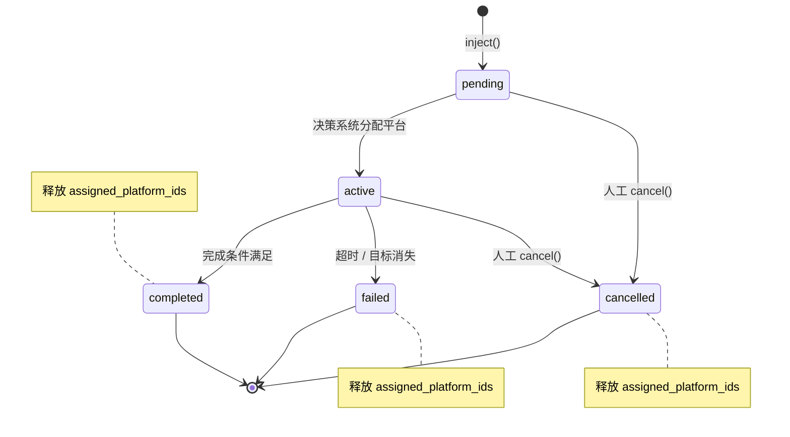
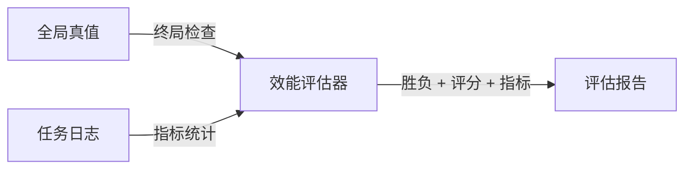

# 任务跟踪器设计

## 1. 概述

TaskTracker（任务跟踪器）是任务的**纯生命周期管理器**（裁判系统）。它不生成任务，不决定"该做什么"——这些属于决策系统的职责。它只负责：

- 接收来自决策系统和人工干预的任务注入
- 跟踪每个任务的状态（pending / active / completed / failed / cancelled）
- 判定任务完成条件（查询态势层）——**所有任务的完成均由裁判系统统一判定**
- 任务终态（完成/失败/取消）时释放已分配平台
- 向决策系统提供当前 active 任务列表

TaskTracker 在仿真和真实部署中代码完全一致。

```mermaid
flowchart LR
    subgraph 注入来源
        DC[决策系统] -->|生成任务| TC[TaskTracker]
        HUMAN[人工干预] -->|注入任务| TC
    end
    
    SA[态势层] -->|只读| TC
    
    TC -->|active 任务列表| DC
    TC -->|任务终态释放| PLAT[平台]
    
    subgraph TaskTracker 内部
        JQ[任务队列 dict<br/>task_id → Task]
        CHECK[完成判定<br/>查态势层/实体字段]
        RELEASE[释放 assigned_platform_ids]
    end
```



**任务不包含控制指令**。控制指令由决策系统直接发往平台，不在 TaskTracker 管理范围内。

**分配信息通过 `assigned_platform_ids` 统一管理**。决策系统在分配平台时写入，TaskTracker 在任务终态时释放。读写权限：
- 决策系统（可读写）
- TaskTracker（终态时释放）
- 其他系统（只读）


## 2. 任务队列

```python
class TaskTracker:
    """任务跟踪器：纯生命周期管理器。通过 self.world 访问态势层和全局时间。"""
    
    def __init__(self, world: "World"):
        self.world = world
        self.tasks: dict[int, Task] = {}  # task_id → Task，扁平字典，不维护父子关系
```

| 操作 | 调用方 | 说明 |
| :--- | :--- | :--- |
| `inject(task)` | 决策系统 / 人工 | 注入新任务，状态 = pending |
| `cancel(task_id)` | 人工 | 取消任务，状态 = cancelled，释放已分配平台 |
| `reprioritize(task_id, priority)` | 人工 | 调整优先级 |
| `get_active()` | 决策系统 | 返回所有 pending + active 任务列表 |
| `get_all()` | 效能评估器 / 日志 | 返回全部任务（含已完成、失败） |

### 生命周期



### 每帧执行

TaskTracker 每帧检查所有 active 任务的完成条件和超时，末尾统一同步 platform.current_task。

```python
def step(self):
    situation = self.world.situation
    for task in self.tasks.values():
        if task.status != TaskStatus.ACTIVE:
            continue

        # 超时检查
        if task.deadline and self.world.time >= task.deadline:
            task.status = TaskStatus.FAILED
            continue

        # 完成条件检查（裁判系统判定）
        if task.is_completed(situation):
            task.status = TaskStatus.COMPLETED

    # 统一同步：根据 assigned_platform_ids 更新所有平台的 current_task
    self._sync_platform_current_task()
```


## 3. 任务类型

### 3.1 任务基类

| 字段 | 类型 | 说明 |
| :--- | :--- | :--- |
| task_id | int | 全局唯一标识 |
| task_type | str | 任务类型标识 |
| priority | int | 优先级，数字越小越高 |
| status | enum | pending / active / completed / failed / cancelled |
| created_time | float | 任务注入时刻 |
| deadline | float / None | 软时限，超时自动 failed |
| required_capabilities | list[str] | 所需能力类型列表 |
| required_platforms | int | 所需平台数量，默认 1 |
| assigned_platform_ids | list[int] | 执行此任务的平台 ID 列表，空列表 = 未分配 |

**分配规则**：决策系统的 PlatformAllocator 在分配时仅写入 `assigned_platform_ids`。TaskTracker 每帧通过 `_sync_platform_current_task()` 将 `assigned_platform_ids` 映射同步到 `platform.current_task`；任务进入终态后，其平台不在任何 PENDING/ACTIVE 任务的分配列表中，`current_task` 自动清空。其他系统只读。

### 3.2 任务类型总览

```
Task（基类）
├── ReconTask              → 查态势层覆盖率
├── DiscoverTask           → 查态势层中某类型 discovered 数量（不绑定具体实体）
├── GuardTask              → 守卫指定区域，场景终止时由效能评估器判定（不绑定具体实体）
├── ArriveTask             → 遍历 assigned_platform_ids，查平台位置判定抵达（人工干预用）
├── OccupyTask             → 遍历 assigned_platform_ids，查平台位置+计时判定驻留（人工干预用）
├── ChargeTask（独立）     → 目标平台的 battery >= threshold（重写完成判定）
└── EntityTask（基类）     → 绑定已发现的目标实体，查实体状态字段
    ├── MedicalDeliveryTask→ 伤员不再受伤（injured == False）
    ├── RescueTask         → 人员已上车（rescued == True）
    ├── InterceptTask      → 目标已被处置（neutralized == True）
    ├── RepairTask         → 设施已修复（repaired == True）
    └── ClearTask          → 残骸已清理（debris_cleared == True）
```

> **DiscoverTask / GuardTask 不继承 EntityTask**：二者均不绑定具体实体。DiscoverTask 在发现目标之前不知道实体是谁；GuardTask 守卫的是区域而非特定实体，通过场景全局目标判定成败。`ChargeTask` 因需要额外字段（充电目标平台 ID）且完成判定逻辑不同，独立实现。

### 3.3 ReconTask（侦察覆盖）

对指定区域或路径进行扫描覆盖。不绑定具体实体。

| 参数 | 类型 | 说明 |
| :--- | :--- | :--- |
| area | Polygon / LineString | 需要覆盖的区域或路径 |
| required_coverage | float | 覆盖率阈值，默认 0.95 |

**完成判定**：逐帧查态势层覆盖记录图，该区域内已覆盖占比达到阈值。

### 3.4 DiscoverTask（搜索发现）

在指定区域内发现指定数量和类型的目标实体。不绑定具体实体——表达式"还有 N 个类型 X 的目标没找到"。

| 参数 | 类型 | 说明 |
| :--- | :--- | :--- |
| target_entity_type | str | 要发现的目标实体类型，如 "person" / "vehicle" / "aerial" |
| required_count | int | 需要发现的数量，默认 1 |
| area | Polygon / None | 限定搜索区域，None 为全图 |

**完成判定**：逐帧查态势层精确实体层，该类型且 `discovered == True` 的实体数量 ≥ `required_count`。

```python
class DiscoverTask(Task):
    """发现任务：不绑定具体实体，按类型+数量判定"""
    
    def __init__(self, target_entity_type: str, required_count: int = 1,
                 area: Polygon | None = None):
        super().__init__()
        self.target_entity_type = target_entity_type
        self.required_count = required_count
        self.area = area
        self.required_capabilities = ["sensor"]
    
    def is_completed(self, situation) -> bool:
        entities = situation.get_entities_by_type(self.target_entity_type)
        discovered_count = sum(1 for e in entities if e.discovered)
        return discovered_count >= self.required_count
```

**与 EntityTask 的关系**：DiscoverTask 不绑定具体实体（在发现目标之前不知道实体是谁），因此不继承 EntityTask。EntityTask 的所有子类（MedicalDelivery / Rescue / Intercept 等）都有一个共同前提——目标已被发现、已有确定的 `target_entity_id` ——这些 ID 由态势层在探测到实体时提供，不存在预分配问题。

### 3.5 GuardTask（区域守卫）

标记需要守卫的战略区域，告知决策系统"哪里必须守住"。场景启动时注入，在整个仿真期间保持 active，由效能评估器在终局判定成败。

**与 InterceptTask 的分工**：

| | GuardTask | InterceptTask |
| :--- | :--- | :--- |
| **绑定对象** | 区域（Polygon） | 具体实体（entity_id） |
| **触发时机** | 场景启动时注入 | HostileTargetRule 发现目标后生成 |
| **语义** | "这个区域必须守住，不能有敌对目标进入" | "处置这个已发现的目标" |
| **给决策系统的信息** | 哪些区域需要提前部署防御力量 | 哪些目标需要分配平台去拦截 |
| **完成条件** | 始终不自行完成（`is_completed()` 始终返回 False） | neutralized == True |

| 参数 | 类型 | 说明 |
| :--- | :--- | :--- |
| area | Polygon | 需要守卫的区域（如核心禁入区、跑道净空区） |
| hostile_entity_types | list[str] | 需要防范的敌对实体类型，默认 ["aerial"] |
| max_intrusions | int | 允许的最大入侵次数，默认 0（零容忍） |

**完成判定**：GuardTask 不自行完成——`is_completed()` 始终返回 False。场景终止（所有目标 neutralized 或时限耗尽）时统一结束，由效能评估器检查守卫区域内入侵记录来判定守卫是否成功。

```python
class GuardTask(Task):
    """区域守卫任务：标记战略要害区域，告诉决策系统"哪里需要守"。不绑定具体实体。"""
    
    def __init__(self, area: Polygon, hostile_entity_types: list[str] = None,
                 max_intrusions: int = 0):
        super().__init__()
        self.area = area
        self.hostile_entity_types = hostile_entity_types or ["aerial"]
        self.max_intrusions = max_intrusions
        # 守卫任务不需要特定能力——决策系统根据任务语义自行决定部署哪些平台
    
    def is_completed(self, situation) -> bool:
        """守卫任务不自行完成，始终由场景终止条件统一结束"""
        return False
```

> **设计说明**：GuardTask 的存在价值是给决策系统提供"战略要害区域"信息。决策系统看到 GuardTask 后，知道核心禁入区需要提前布防，可将 UAV 部署在核心区外围形成防线，而非等 InterceptTask 生成后才被动反应。GuardTask 与 ReconTask 正交——ReconTask 要求"搜索覆盖"，GuardTask 要求"持续守卫、零入侵"。

### 3.6 ArriveTask（抵达到位）— 人工干预专用

平台抵达指定位置。由 TaskTracker 裁判系统判定：至少 `required_platforms` 个已分配平台进入目标半径即完成。

| 参数 | 类型 | 说明 |
| :--- | :--- | :--- |
| target_pos | (x, y) | 目标坐标 |
| radius | float | 判定半径，默认 50m |

**完成判定**：遍历 `assigned_platform_ids` 中已分配平台的位置，通过态势层查询，距目标点 < radius 的平台数 ≥ `required_platforms`。

```python
class ArriveTask(Task):
    def is_completed(self, situation) -> bool:
        """裁判系统判定：至少 required_platforms 个已分配平台到达目标半径内。"""
        arrived = 0
        for pid in self.assigned_platform_ids:
            platform = situation.get_platform_by_id(pid)
            if platform is not None:
                if platform.distance_to_pos(self.target_pos) < self.radius:
                    arrived += 1
        return arrived >= self.required_platforms
```

> **平台行为**：平台在 `update_control` 中只需从 `self.current_task` 读取目标位置并导航，不自行修改任务状态。任务完成后由 TaskTracker 释放其 `current_task`。

### 3.7 OccupyTask（驻留完成）— 人工干预专用

平台在目标位置连续停留指定时长。由 TaskTracker 裁判系统判定：至少 `required_platforms` 个已分配平台在目标半径内连续驻留 `hold_time` 秒即完成，中途离开半径则计时归零。

| 参数 | 类型 | 说明 |
| :--- | :--- | :--- |
| target_pos | (x, y) | 目标坐标 |
| radius | float | 判定半径，默认 50m |
| hold_time | float | 需要连续停留的秒数 |

**完成判定**：遍历 `assigned_platform_ids` 中已分配平台的位置，记录每个平台首次进入目标半径的时刻。若平台离开半径，计时归零。连续驻留 ≥ `hold_time` 的平台数 ≥ `required_platforms` 即完成。

```python
class OccupyTask(Task):
    def __init__(self, ...):
        ...
        self._arrive_times: dict[int, float] = {}   # 平台 ID → 首达时间

    def is_completed(self, situation) -> bool:
        """裁判系统判定：至少 required_platforms 个已分配平台连续驻留 hold_time 秒。"""
        current_time = situation.world.time
        occupied = 0
        for pid in self.assigned_platform_ids:
            platform = situation.get_platform_by_id(pid)
            if platform is None:
                continue
            if platform.distance_to_pos(self.target_pos) < self.radius:
                if pid not in self._arrive_times:
                    self._arrive_times[pid] = current_time
                elif current_time - self._arrive_times[pid] >= self.hold_time:
                    occupied += 1
            else:
                self._arrive_times.pop(pid, None)                # 离开，归零
        return occupied >= self.required_platforms
```

> **平台行为**：平台在 `update_control` 中只需从 `self.current_task` 读取目标位置并导航，不自行修改任务状态。

### 3.8 EntityTask（实体任务基类）

通过查询态势层中的实体状态字段判定完成。所有子类（MedicalDelivery / Rescue / Intercept / Repair / Clear）都有一个共同前提——目标已被态势层发现、已有确定的 `target_entity_id`。

| 参数 | 类型 | 说明 |
| :--- | :--- | :--- |
| target_entity_id | int | 目标实体 ID |
| check_field | str | 查询的实体字段名 |
| check_value | Any | 期望值 |

```python
def is_completed(self, situation) -> bool:
    entity_state = situation.get_entity(self.target_entity_id)
    if entity_state is None:
        return False
    return getattr(entity_state, self.check_field) == self.check_value
```

#### 各子类判定表

| 子类 | check_field | check_value | 完成含义 |
| :--- | :--- | :--- | :--- |
| MedicalDeliveryTask | "injured" | False | 伤员已收到急救物资（投送立刻生效，injured → False） |
| RescueTask | "rescued" | True | 人员已被 UGV 接上 |
| InterceptTask | "neutralized" | True | 目标已被处置 |
| RepairTask | "repaired" | True | 设施已修复 |
| ClearTask | "debris_cleared" | True | 残骸已被清理（neutralized 后） |

### 3.9 ChargeTask（充电）

ChargeTask 独立于 EntityTask 实现，因为它需要额外的充电目标平台字段，且检查的是己方平台（而非 TargetEntity）的状态字段。

**分配约定**：
- `assigned_platform_ids` = 需要充电的 UAV ID 列表（仅包含 UAV，不包含 charger UGV）
- `charger_platform_id`：执行充电的 UGV ID，由决策系统分配时填写
- 每个需要充电的 UAV 生成一个独立的 ChargeTask（一个 charger 可同时服务多个 ChargeTask）

| 参数 | 类型 | 说明 |
| :--- | :--- | :--- |
| target_entity_id | int | **需要充电的平台 ID**（如电量不足的 UAV），即任务目标 |
| charger_platform_id | int / None | 执行充电的平台 ID（由决策系统分配时填写） |
| battery_threshold | float | 充电目标电量阈值，默认 0.9（90%） |
| assigned_platform_ids | list[int] | [target_entity_id]，仅包含需要充电的 UAV，不包含 charger |

**完成判定**：查询态势层中 `target_entity_id` 对应平台的 battery 字段，≥ battery_threshold 即完成。

```python
class ChargeTask(Task):
    """充电任务：目标平台电量恢复到阈值以上。"""

    def __init__(self, target_entity_id: int, battery_threshold: float = 0.9):
        super().__init__()
        self.target_entity_id = target_entity_id      # 需要充电的平台
        self.charger_platform_id = None                # 执行充电的平台（决策系统填写）
        self.battery_threshold = battery_threshold
        self.required_capabilities = ["charger"]

    def is_completed(self, situation) -> bool:
        """检查目标平台电量是否已达阈值"""
        entity_state = situation.get_entity(self.target_entity_id)
        if entity_state is None:
            return False
        return entity_state.extra.get("battery", 0.0) >= self.battery_threshold
```

> **流程说明**：LowBatteryRule 发现 UAV 电量低 → 生成 ChargeTask(target_entity_id = UAV的ID) → 决策系统找到携带 charger 能力的 UGV，设置 charger_platform_id、将 UAV ID 写入 assigned_platform_ids → TaskTracker 同步 UAV 的 current_task → UAV 飞向 charger（通过 charger_platform_id 查找位置），charger 作为停机坪不绑定此任务、可同时服务多个 UAV 并执行其他任务 → 换电完成后 battery 恢复，TaskTracker 判定完成。


## 4. 全局目标

全局目标是场景的胜负判定依据，由**效能评估器**在仿真结束时基于全局真值检查。全局目标不暴露给指控系统。

| 场景 | 全局目标 | 失败条件 |
| :--- | :--- | :--- |
| 边境巡检 | 边境线覆盖率≥95%；所有真实异常已处置 | 任一人/车辆逃逸；设施异常超时未处理 |
| 区域封控 | 核心区入侵次数=0；所有黑飞目标已拦截 | 任一黑飞进入核心禁入区 |
| 搜救 | 成功救援人数≥4（共5人） | 任务时限耗尽时救援人数＜4 |

评分制：

```
总分 = 覆盖率得分 + 处置得分 + 资源效率得分 - 违规扣分
```


## 5. 效能评估器（Evaluator，仅仿真）

基于全局真值做终局判定和指标统计。仿真结束时调用。



### 与 TaskTracker 的关系

| TaskTracker 认为 | 效能评估器验证 |
| :--- | :--- |
| InterceptTask 完成（态势层说 neutralized=True） | 真值中目标确实 neutralized，且未进入核心区 |
| RescueTask 完成（态势层说 rescued=True） | 真值中人员确实 rescued，且 survival_time > 0 |
| 覆盖率达到 95% | 真值覆盖记录（不受通信遮蔽影响） |

### 典型指标

```python
class Evaluator:
    """效能评估器：基于 World（全局真值）做终局判定和指标统计。
    
    World 本身持有所有实体的真实状态，是唯一的真值来源。
    评估器通过 world.entities 和 world.situation.coverage 读取真值，
    而非通过 SituationManager 的态势副本，确保评估结果不受通信/感知限制影响。
    """
    
    def evaluate(self, world: "World", task_tracker: "TaskTracker") -> dict:
        """
        Args:
            world: World 实例，作为全局真值来源
            task_tracker: TaskTracker 实例，提供任务日志
        Returns:
            评估报告字典
        """
        return {
            # 通用
            "task_completion_rate": ...,
            "avg_response_time": ...,           # 任务注入 → 首平台到达
            "platform_utilization": ...,        # 平台有效任务时间 / 总时间
            
            # 场景特定
            "coverage_rate": ...,               # 边境/搜救
            "rescue_count": ...,                # 搜救
            "intercept_success_rate": ...,      # 封控/边境
            "core_zone_violations": ...,        # 封控
            "synergy_gain": ...,                # 对比基准方案
        }
```


## 6. 优先级规则

| 优先级值 | 用途 |
| :--- | :--- |
| 0-10 | 最高优先级（GuardTask、InterceptTask、人工紧急插入） |
| 20-50 | 高优先级（RescueTask、ChargeTask） |
| 60-80 | 中等优先级（DiscoverTask、MedicalDeliveryTask、RepairTask） |
| 90-100 | 低优先级（ReconTask） |
