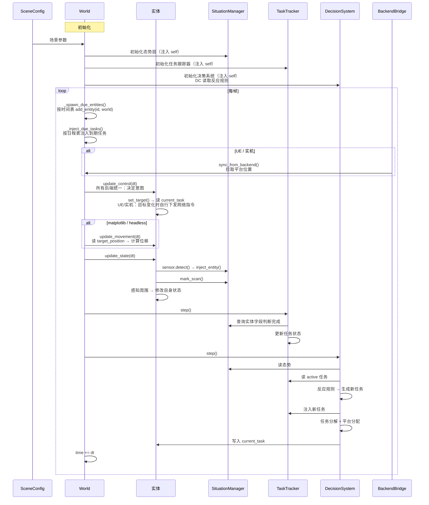
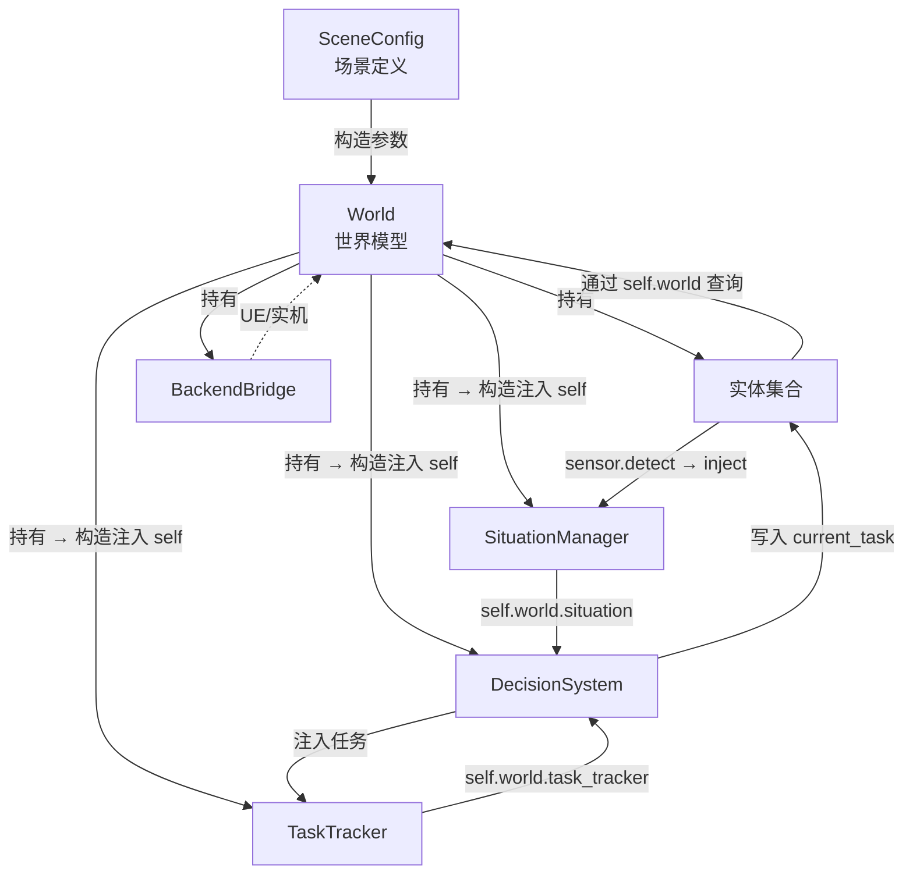

# 场景与世界模型设计

## 1. 概述

世界模型（World）是仿真的驱动器。它读取场景定义，管理实体生命周期，按帧驱动态势层、任务跟踪器和决策系统。场景定义（SceneConfig）则以纯 Python 代码直接实例化实体、配置参数、编排时间表。

### 核心职责

| 职责       | 说明                                                |
| :------- | :------------------------------------------------ |
| 读取场景定义   | 区域参数、侵蚀速度表、可通行图、静态先验、任务日程表、反应规则                    |
| 管理实体生命周期 | 按时间表生成实体，注入世界引用，管理启用/禁用                           |
| 驱动系统帧循环  | 每帧按序调用：实体更新 → TaskTracker → 决策系统                  |
| 后端抽象     | matplotlib / headless / UE / 实机，差异封装在 `tick()` 内部 |
| 提供实体查询   | 范围查询、平台列表、可通行性判断等                                 |

### 定位

```
┌─────────────────────────────────────────────────┐
│                   World                          │
│                                                  │
│  entities: dict[id, BaseEntity]                  │
│  situation: SituationManager                     │
│  task_tracker: TaskTracker                       │
│  decision_system: DecisionSystem                 │
│                                                  │
│  查询接口（供实体 update 使用）                    │
│  驱动接口（tick）                                  │
│  后端桥接（UE / 实机）                             │
└─────────────────────────────────────────────────┘
```

World 不直接操控实体的运动或状态——实体在 `update()` 中自主决策。World 只提供查询接口和时间驱动。

***

## 2. 场景定义（SceneConfig）

场景定义是一个纯 Python 数据类。构建场景时直接实例化实体、配置参数，不需要模板或工厂方法。

```python
@dataclass
class SceneConfig:
    """场景定义，包含 World 初始化所需的一切"""
    
    # === 世界参数 ===
    name: str                          # 场景名称
    width: float                       # 区域宽度（米）
    height: float                      # 区域高度（米）
    resolution: float = 50.0           # 网格分辨率（米），影响态势层网格精度
    dt: float = 1.0                    # 仿真步长（秒）
    max_duration: float = 7200.0       # 最大仿真时间（秒）
    
    # === 侵蚀速度表：实体类型 → 最大速度(m/s) ===
    # 决策系统按实体类型分别查询新鲜度/优先级图
    erosion_speeds: dict[str, float] = field(default_factory=dict)
    
    # === 静态先验 ===
    # 价值图的基础分布：uniform / border_decay / perimeter_decay
    value_prior: ValuePriorConfig = field(default_factory=ValuePriorConfig)
    
    # === 可通行图 ===
    obstacles: list[Obstacle] = field(default_factory=list)
    roads: list[Road] = field(default_factory=list)
    
    # === 生成时间表：(时刻(秒), 实体) 列表 ===
    # 实体在创建时不持有 world 引用，也不分配 ID
    # World.tick() 按时刻将实体加入世界时才赋值 ID 并注入 world 引用
    spawn_schedule: list[tuple[float, BaseEntity]] = field(default_factory=list)
    
    # === 决策配置 ===
    reaction_rules: list[ReactionRule] = field(default_factory=list)

    # === 任务日程表：(时刻(秒), Task) 列表 ===
    # 与 spawn_schedule 模式一致，T=0 即初始任务，后续时刻为模拟人工干预
    # World.tick() 在对应时刻自动注入 TaskTracker
    task_schedule: list[tuple[float, Task]] = field(default_factory=list)
    
    # === 全局目标（效能评估用） ===
    global_goal: GlobalGoal | None = None
```

***

## 3. 世界模型（World）

### 3.1 构造与初始化

```python
class World:
    """统一世界模型。
    
    读取场景配置，管理实体生命周期，驱动态势、任务、决策系统。
    后端差异（matplotlib / headless / UE / 实机）封装在 tick() 内部，
    实体和核心系统不感知后端。
    """
    
    def __init__(self, config: SceneConfig, backend: str = "headless"):
        # === 场景参数 ===
        self.config = config
        self.width = config.width
        self.height = config.height
        self.resolution = config.resolution
        self.dt = config.dt
        self.max_duration = config.max_duration
        self.backend = backend
        
        # === 时间 ===
        self.time: float = 0.0
        
        # === 实体管理 ===
        # ID 由 World 自增分配（从 0 开始），是系统内唯一标识。
        # UE / 实机后端通过 Bridge 同步时，以我方 ID 为准；
        # UE 侧通过配置文件将引擎内实体映射到我方 ID 体系。
        self.entities: dict[int, BaseEntity] = {}
        self._next_entity_id: int = 0
        self._pending_spawns: list[tuple[float, BaseEntity]] = sorted(
            config.spawn_schedule, key=lambda x: x[0]
        )

        # 任务日程表
        self._pending_tasks: list[tuple[float, object]] = sorted(
            config.task_schedule, key=lambda x: x[0]
        )
        
        # === 核心系统（所有后端共用） ===
        self.situation = SituationManager(self)
        self.task_tracker = TaskTracker(self)
        self.decision_system = DecisionSystem(self)
        
        # === 后端桥接 ===
        self._bridge = self._create_backend_bridge()
    
    def _create_backend_bridge(self):
        """根据后端类型创建桥接器"""
        if self.backend == "ue":
            return UEBridge()
        elif self.backend == "reality":
            return GroundStationBridge()
        return None  # matplotlib / headless 不需要桥接
```

### 3.2 实体生命周期

实体在场景配置中直接实例化，但不持有 `world` 引用、也不分配 `id`——这些在加入世界时由 `World.add_entity()` 赋值：

```python
def add_entity(self, entity: BaseEntity):
    """将实体加入世界。
    
    赋值全局唯一 ID，注入 world 引用。
    实体在此之后才能通过 self.world 查询周围环境。
    """
    entity.id = self._next_entity_id
    self._next_entity_id += 1
    entity.world = self
    self.entities[entity.id] = entity

def _spawn_due_entities(self):
    """生成当前时刻到期的待加入实体"""
    while self._pending_spawns and self._pending_spawns[0][0] <= self.time:
        _, entity = self._pending_spawns.pop(0)
        self.add_entity(entity)
```

实体在场景配置中被实例化的例子（搜救场景）：

```python
def build_search_rescue_scene() -> SceneConfig:
    config = SceneConfig(
        name="荒野搜救",
        width=10000, height=10000,
        resolution=50, dt=1.0,
        max_duration=7200.0,
        erosion_speeds={"person": 2.0},
        value_prior=UniformPrior(),
        obstacles=[CliffZone((3000, 4000), 500), Gully((7000, 2000), 800, 100)],
        task_schedule=[
            (0.0, ReconTask(area=任务区域, required_coverage=0.90)),
            (0.0, DiscoverTask(target_entity_type="person", required_count=5)),
        ],
        reaction_rules=[
            PersonDiscoveredRule(),
            InjuryHandledRule(),
            LowBatteryRule(threshold=0.2),
        ],
        global_goal=RescueGoal(min_rescued=4),
    )
    
    schedule: list[tuple[float, BaseEntity]] = []
    
    # 平台：T=0 生成
    for i in range(4):
        schedule.append((
            0.0,
            PlatformEntity(
                platform_type="uav",
                position=(1000.0 + i * 500, 1000.0),
                max_speed=15.0, max_battery=3600.0,  # 60分钟 → 3600秒
                capabilities=[
                    SensorCapability(range=500),
                    MedicalCapability(stock=3),
                ],
            )
        ))
    for i in range(2):
        schedule.append((
            0.0,
            PlatformEntity(
                platform_type="ugv",
                position=(1000.0 + i * 600, 800.0),
                max_speed=8.0, max_battery=10800.0,  # 180分钟 → 10800秒
                capabilities=[
                    SensorCapability(range=200),
                    ChargerCapability(stock=6),
                    CargoCapability(capacity=5),
                ],
            )
        ))
    
    # 失踪人员：随机5人，前2人受伤
    for i in range(5):
        schedule.append((
            0.0,
            PersonTarget(
                role="victim",
                position=(random.uniform(1000, 9000), random.uniform(1000, 9000)),
                survival_time=random.uniform(7200, 18000),  # 120~300分钟 → 7200~18000秒
                injured=(i < 2),
            )
        ))
    
    config.spawn_schedule = schedule
    return config
```

### 3.3 实体查询接口

实体在 `update()` 中通过 `self.world.xxx()` 查询上下文：

```python
def get_entities_in_range(self, pos: tuple[float, float], radius: float) -> list[BaseEntity]:
    """查询指定位置半径内的所有实体。O(n) 遍历，适合当前实体规模。"""
    result = []
    r2 = radius * radius
    for entity in self.entities.values():
        if not entity.enabled:
            continue
        dx = entity.position[0] - pos[0]
        dy = entity.position[1] - pos[1]
        if dx * dx + dy * dy <= r2:
            result.append(entity)
    return result

def get_platforms(self) -> list["PlatformEntity"]:
    """获取所有己方平台"""
    return [e for e in self.entities.values()
            if isinstance(e, PlatformEntity) and e.enabled]

def get_targets(self) -> list["BaseEntity"]:
    """获取所有目标实体（非平台、非线索）"""
    return [e for e in self.entities.values()
            if not isinstance(e, PlatformEntity) and not isinstance(e, CueEntity)
            and e.enabled]

def is_passable(self, pos: tuple[float, float]) -> bool:
    """查询可通行性（委托态势层）"""
    return self.situation.is_passable(pos)

def get_move_cost(self, pos: tuple[float, float]) -> float:
    """获取通行成本（委托态势层）"""
    return self.situation.get_move_cost(pos)

def get_erosion_speed(self, entity_type: str) -> float:
    """查询指定实体类型的侵蚀速度"""
    return self.config.erosion_speeds.get(entity_type, 0.0)
```

### 3.4 每帧驱动（tick）

```python
def tick(self):
    """执行一帧仿真。
    
    流程：
        1. 按时间表加入到期实体
        1.5. 按日程表注入到期任务（T=0 初始任务 + 后续人工干预）
        2. 后端同步（UE / 实机：从外部拉取平台位置）
        3. 控制决策（所有后端统一：根据 current_task 决定意图，UE/实机后端由实体自行下发指令）
        4. 运动执行（matplotlib / headless：实体自行计算位置）
        5. 实体状态（所有后端统一：感知 + 状态变更 + 传感器探测）
        6. TaskTracker 检查完成条件
        7. 决策系统（反应规则 + 分解 + 分配）
    """
    
    # 1. 按时间表加入实体
    self._spawn_due_entities()
    
    # 1.5. 按时注入日程任务（T=0 初始任务 + 后续人工干预）
    self._inject_due_tasks()
    
    # 2. 后端同步：从 UE / 实机拉取平台位置
    if self._bridge is not None:
        self._bridge.sync_from_backend(self)
    
    # 3. 控制决策（所有后端统一）
    #    UE / 实机后端：set_target() 内部检测目标变化时自行下发网络指令
    for entity in list(self.entities.values()):
        if entity.enabled:
            entity.update_control(self.dt)
    
    # 4. 运动执行（仅 Python 后端）
    if self._bridge is None:
        for entity in list(self.entities.values()):
            if entity.enabled:
                entity.update_movement(self.dt)
    
    # 5. 实体状态（所有后端统一）
    for entity in list(self.entities.values()):
        if not entity.enabled:
            continue
        entity.update_state(self.dt)
    
    # 6. TaskTracker 检查 active 任务完成条件
    self.task_tracker.step()
    
    # 7. 决策系统
    self.decision_system.step()
    
    self.time += self.dt
```

步骤 3 和 4 的分离是关键：**控制决策是"想去哪"，所有后端统一；运动执行是"怎么去"，后端相关**。`update_control` 设置 `target_position` 和 `desired_speed`——在 Python 后端由 `update_movement` 读取计算位移，在 UE / 实机后端由 Bridge 读取并下发为导航指令。

***

## 4. 后端桥接

### 4.1 后端类型

| 后端             | 运动来源                        | 位置同步方向                                    | 指令下发方式                                      | 渲染            |
| :------------- | :-------------------------- | :---------------------------------------- | :------------------------------------------ | :------------ |
| **headless**   | 实体 `update_movement()` 自行计算 | 无                                         | 无                                           | 无             |
| **matplotlib** | 同上                          | 无                                         | 无                                           | Matplotlib 动画 |
| **ue**         | UE 引擎物理/导航                  | UE → Python (`_bridge.sync_from_backend`) | 实体 `set_target()` 内调 `send_move_command` | UE 引擎         |
| **reality**    | 实机 GPS/IMU                  | 实机 → Python（地面站链路）                        | 实体 `set_target()` 内调 `send_move_command` | 地面站 UI        |

### 4.2 桥接器接口

```python
class BackendBridge(ABC):
    """后端桥接器抽象基类。
    
    指令下发由实体在 update_control 中通过 set_target() 主动触发，
    仅在目标变化时发送，避免每帧全量广播。
    """
    
    @abstractmethod
    def sync_from_backend(self, world: "World"):
        """从外部后端同步实体状态到 World。
        
        UE 模式：从 UE 拉取所有平台的位置、速度、航向
        实机模式：从地面站数据链路获取平台 GPS 坐标等
        """
        pass
    
    @abstractmethod
    def send_move_command(self, entity_id: int, target_pos: tuple, speed: float):
        """向指定实体下发移动指令（由实体 set_target 调用，仅在目标变化时触发）"""
        pass
    
    @abstractmethod
    def send_stop_command(self, entity_id: int):
        """向指定实体下发停止指令（由实体 set_target(None) 调用）"""
        pass
```

### 4.3 UE 桥接示例

```python
class UEBridge(BackendBridge):
    """UE 引擎桥接器：TCP/WebSocket 通信，同步实体状态与下发指令。
    
    sync_from_backend 每帧拉取所有平台位置（批量）；
    send_move_command 由实体 set_target() 按需调用，仅目标变化时触发。
    """
    
    def __init__(self, host: str = "127.0.0.1", port: int = 9000):
        self._conn = None  # 实际实现中建立 TCP/WS 连接
    
    def sync_from_backend(self, world: "World"):
        """从 UE 拉取所有实体的最新位置"""
        # 实际实现：接收 UE 发来的 entity_states 消息
        # updates = self._conn.recv_entity_states()
        # for entity_id, pos, vel, heading in updates:
        #     entity = world.entities.get(entity_id)
        #     if entity:
        #         entity.position = pos
        #         entity.velocity = vel
        #         entity.heading = heading
        pass
    
    def send_move_command(self, entity_id: int, target_pos: tuple, speed: float):
        """下发移动指令（由实体 set_target 按需调用）"""
        # self._conn.send_move_command(entity_id, target_pos, speed)
        pass
    
    def send_stop_command(self, entity_id: int):
        """下发停止指令"""
        # self._conn.send_stop_command(entity_id)
        pass
```

### 4.4 实机桥接示例

```python
class GroundStationBridge(BackendBridge):
    """地面站桥接器：通过 MAVLink / 私有协议连接实机
    
    与 UE 桥接结构完全一致，差异仅在通信协议和坐标转换。
    """
    
    def sync_from_backend(self, world: "World"):
        """从地面站数据链路获取平台状态"""
        pass
    
    def send_move_command(self, entity_id: int, target_pos: tuple, speed: float):
        """通过 MAVLink 上传航点指令"""
        pass
    
    def send_stop_command(self, entity_id: int):
        """通过 MAVLink 发送悬停/停止指令"""
        pass
```

***

## 5. 实体运动逻辑

实体在场景配置中直接实例化，运动逻辑仅存在于实体内部。Python 后端（matplotlib / headless）下实体自行计算位移；UE / 实机后端下 `update_movement()` 为空操作。

### 5.1 BaseEntity 接口

实体在创建时不持有 `world` 和 `id`，由 `World.add_entity()` 注入：

```python
class BaseEntity:
    """实体基类"""
    
    def __init__(self, position: tuple[float, float] = (0.0, 0.0)):
        self.id: int = -1                    # World.add_entity() 赋值
        self.world: World | None = None       # World.add_entity() 注入
        self.position = position
        self.velocity: tuple[float, float] = (0.0, 0.0)
        self.heading: float = 0.0
        self.enabled: bool = True
    
    def update_movement(self, dt: float):
        """运动逻辑。
        
        仅在 Python 后端（matplotlib / headless）调用。
        UE / 实机后端下位置由外部同步，此方法为空。
        """
        pass
    
    def update_state(self, dt: float):
        """状态逻辑。
        
        所有后端统一调用。感知周围实体、修改自身状态字段、
        调用传感器探测等。
        """
        pass
    
    def distance_to(self, other: "BaseEntity") -> float:
        """计算到另一个实体的欧氏距离"""
        dx = self.position[0] - other.position[0]
        dy = self.position[1] - other.position[1]
        return math.sqrt(dx * dx + dy * dy)
```

### 5.2 各实体的运动逻辑（Python 后端）

控制意图由 `update_control` 决定（target_position），`update_movement` 仅负责按意图计算位移：

| 实体                | update_movement 运动执行                         | 复杂度    |
| :---------------- | :--------------------------- | :----- |
| **UAV**           | 向 target_position 匀速直线飞行，忽略地形   | \~20 行 |
| **UGV**           | 沿 A\* 路径向 target_position 行驶（用可通行图），避开障碍物      | \~50 行 |
| **PersonTarget**  | victim 静止；intruder 向纵深随机游走   | \~15 行 |
| **AerialTarget**  | 向 intent\_point 直线飞，被跟踪时随机转向 | \~20 行 |
| **VehicleTarget** | 沿道路航点序列行驶                    | \~20 行 |
| **CueEntity**     | 静止（不参与运动）                    | 0 行    |

所有运动执行仅用于 Python 后端，整体规模在 200 行以内。UE / 实机模式下由引擎或物理世界替代，控制意图由 `set_target()` 下发。

***

## 6. 完整数据流



***

## 7. 初始化与运行示例

```python
# 1. 构建场景配置（纯 Python，直接实例化）
config = build_search_rescue_scene()

# 2. 创建 World
world = World(config, backend="matplotlib")  # 或 "headless" / "ue" / "reality"

# 3. 运行仿真主循环
while world.time < world.max_duration:
    world.tick()
    
    # 可选：matplotlib 渲染
    if world.backend == "matplotlib":
        world.renderer.draw(world)

# 4. 效能评估
evaluator = Evaluator()
report = evaluator.evaluate(world, world.task_tracker)
print(report)
```

headless 模式适用于批量测试和 CI：

```python
config = build_search_rescue_scene()
world = World(config, backend="headless")

while world.time < world.max_duration:
    world.tick()
    # 检查提前终止条件（全部人员已 rescue 等）
    if global_goal_met(world):
        break

evaluator = Evaluator()
return evaluator.evaluate(world, world.task_tracker)
```

***

## 8. 与其他系统的关系



- **SceneConfig** 是纯数据，定义场景的一切参数
- **World** 是唯一持有所有子系统的"上帝对象"，提供实体查询、时间驱动
- 实体在加入 World 后才获得 `id` 和 `world` 引用，才能查询周围环境
- **后端桥接** 是可选的：Python 后端不需要，UE / 实机后端通过桥接器收发数据

