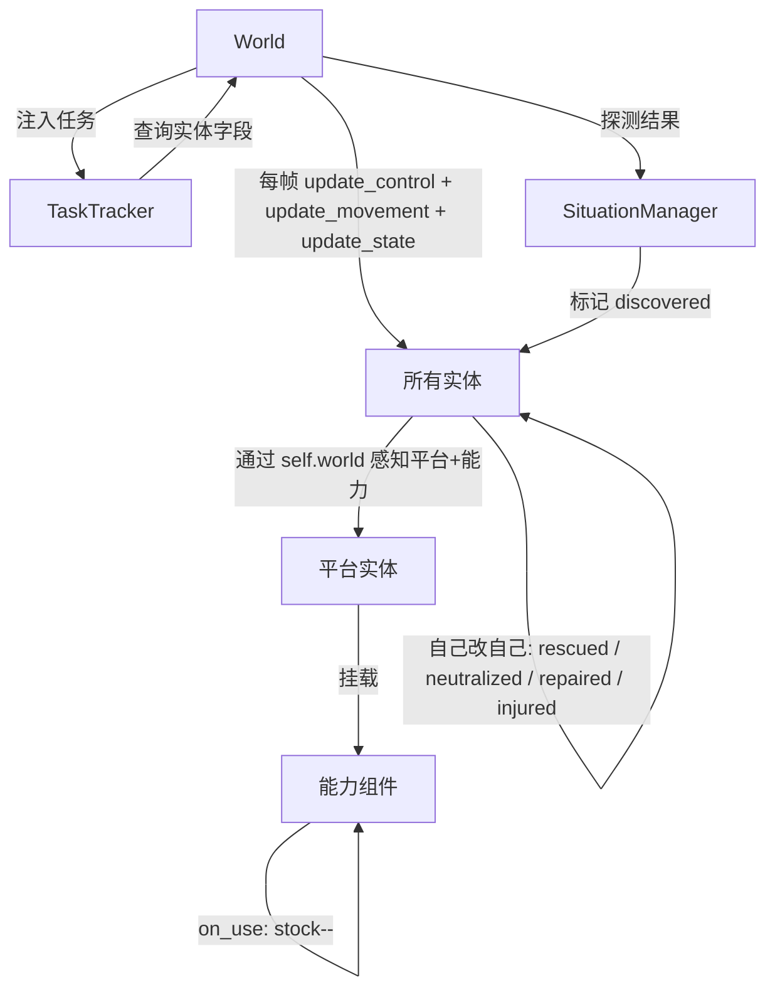

# 实体与能力系统设计

## 1. 概述

实体是仿真世界中所有可感知对象的基本单元，包括己方平台、各类目标和环境线索。能力是平台可携带的功能组件，决定平台能执行何种任务。

**核心设计原则**：实体自己管理自己的状态变更。实体在 `update_control(dt)` 中决定意图、`update_movement(dt)` 中执行位移（仅 Python）、`update_state(dt)` 中通过 `self.world` 感知周围平台和能力并自主决定状态变化。裁判系统只读取实体字段判定任务完成，不修改实体状态。

实体由 World 管理生命周期，在加入世界时注入 `world` 引用。态势层维护感知副本。

### 系统架构




## 2. 实体基类（BaseEntity）

所有实体的公共基类，定义最基本的属性和接口。

### 2.1 属性

| 字段 | 类型 | 说明 |
| :--- | :--- | :--- |
| id | int | 全局唯一标识，由 World.add_entity() 赋值 |
| world | World / None | 世界引用，由 World.add_entity() 注入 |
| entity_type | str | 实体类别标识 |
| position | tuple[float, float] | 当前位置 (x, y) |
| velocity | tuple[float, float] | 当前速度 (vx, vy) |
| heading | float | 当前朝向（弧度） |
| timestamp | float | 状态对应的仿真时刻 |
| enabled | bool | 是否参与仿真更新 |

### 2.2 接口

实体每帧经历三个步骤。`update_control` 和 `update_state` 在所有后端统一调用；`update_movement` 仅在 Python 后端调用，UE / 实机后端下位置由 Bridge 同步。

```python
class BaseEntity:
    def __init__(self):
        self.id: int = -1                    # World.add_entity() 赋值
        self.world: "World | None" = None    # World.add_entity() 注入
    
    def update_control(self, dt: float):
        """控制决策。所有后端统一调用。
        
        根据 current_task 和态势决定意图：目标坐标、期望速度、悬停/降落等。
        在 Python 后端，update_movement 读取这些意图执行位移；
        在 UE / 实机后端，Bridge 读取这些意图下发指令。
        """
        pass
    
    def update_movement(self, dt: float):
        """运动执行。仅在 Python 后端调用。
        
        读取 update_control 设定的目标坐标、期望速度等，计算实际位移。
        UE / 实机后端下位置由 Bridge 同步，此方法为空。
        """
        pass

    def update_state(self, dt: float):
        """状态逻辑。所有后端统一调用。
        
        感知周围实体、修改自身状态字段、调用传感器探测等。
        """
        pass

    def get_position(self) -> tuple[float, float]:
        """返回当前位置"""
        pass

    def get_distance_to(self, other: "BaseEntity") -> float:
        """计算到另一实体的距离"""
        pass
```


## 3. 平台实体（PlatformEntity）

平台是己方可控的执行单元，包括多旋翼无人机（UAV）和无人车（UGV）。注意：不包含固定翼无人机，所有空中平台统一为多旋翼 UAV，通过能力挂载区分角色。

### 3.1 属性

| 字段 | 类型 | 说明 |
| :--- | :--- | :--- |
| platform_type | str | "uav" 或 "ugv" |
| can_fly | bool | True = 无视地形，False = 受通行图约束 |
| battery | float | 当前电量（秒续航） |
| max_battery | float | 最大电量（秒） |
| capabilities | list[Capability] | 搭载的能力组件列表 |
| current_task | Task / None | 当前被分配的任务，由 TaskTracker 根据 assigned_platform_ids 同步写入；平台据此自主生成控制指令 |
| landed_on | int / None | 当前停靠的平台 ID（充电中为 UGV 的 ID，非充电时为 None） |
| charge_timer | float | 换电倒计时（秒），仅 `landed_on` 非空时有效；归零时完成换电 |

### 3.2 行为更新

平台每帧经历三步：`update_control`（决定意图）→ `update_movement`（执行位移，仅 Python）→ `update_state`（感知 + 状态）。`current_task` 由决策系统直接写入，平台据此自主决定。

**控制意图字段**（通过 `set_target()` 写入，`update_movement` 读取）：

| 字段 | 类型 | 说明 |
| :--- | :--- | :--- |
| target_position | tuple / None | 目标坐标，None 表示无移动意图 |
| desired_speed | float | 期望移动速度（m/s） |

```python
class PlatformEntity(BaseEntity):
    # === 控制意图（所有后端统一） ===
    target_position: tuple[float, float] | None = None
    desired_speed: float = 0.0
    
    def set_target(self, pos: tuple[float, float] | None, speed: float = 0.0):
        """设置移动目标。仅在目标变化时发送网络指令，避免每帧全量广播。
        
        Python 后端：仅修改字段值，无网络开销。
        UE / 实机后端：目标变化时立即调用 Bridge 下发指令。
        """
        changed = (self.target_position != pos or self.desired_speed != speed)
        self.target_position = pos
        self.desired_speed = speed
        
        if changed and self.world._bridge is not None:
            if pos is not None:
                self.world._bridge.send_move_command(self.id, pos, speed)
            else:
                self.world._bridge.send_stop_command(self.id)
    
    def update_control(self, dt):
        """控制决策：根据 current_task 决定意图（所有后端统一调用）。
        
        通过 set_target() 设定目标坐标和速度。
        Python 后端由 update_movement 读 target_position 计算位移；
        UE / 实机后端由 set_target 内部直接下发网络指令。
        """
        if self.landed_on is not None:
            self.set_target(None)
            return
        
        task = self.current_task
        if task is None:
            self.set_target(None)
            return
        
        if isinstance(task, ReconTask):
            # 根据覆盖算法计算下一个扫描航点
            wp = self._next_scan_waypoint(task.area)
            self.set_target(wp, self.max_speed)
        elif isinstance(task, MedicalDeliveryTask):
            target = self.world.situation.get_entity(task.target_entity_id)
            if target is not None:
                self.set_target(target.position, self.max_speed)
        elif isinstance(task, ChargeTask):
            ugv = self.world.situation.get_platform_by_id(task.charger_platform_id)
            if ugv is not None:
                self.set_target(ugv.position, self.max_speed)
                # 抵达UGV附近（如5m内）：触发降落
                if self.distance_to(ugv) < 5.0:
                    self.landed_on = ugv.id
                    self.charge_timer = 300.0  # 换电耗时300秒（5分钟）
        elif isinstance(task, InterceptTask):
            target = self.world.situation.get_entity(task.target_entity_id)
            if target is not None:
                self.set_target(target.position, self.max_speed)
        elif isinstance(task, ArriveTask):
            self.set_target(task.target_pos, self.max_speed)
        # ... 其他任务类型
    
    def update_movement(self, dt):
        """运动执行：根据控制意图计算位移（仅 Python 后端调用）。
        
        读取 self.target_position 和 self.desired_speed，
        计算匀速直线位移（UAV）或 A* 路径跟随（UGV）。
        UE / 实机后端跳过此方法，由引擎或物理世界替代。
        """
        if self.target_position is None:
            return
        
        dx = self.target_position[0] - self.position[0]
        dy = self.target_position[1] - self.position[1]
        dist = math.sqrt(dx * dx + dy * dy)
        if dist < 1.0:
            return  # 已到达
        
        step = min(self.desired_speed * dt, dist)
        self.position = (
            self.position[0] + dx / dist * step,
            self.position[1] + dy / dist * step,
        )
    
    def update_state(self, dt):
        """状态逻辑：换电倒计时、传感器探测、电量消耗、能力可用性更新"""
        
        # === 换电逻辑（仅 UAV，UGV 无感知） ===
        if self.landed_on is not None:
            self.charge_timer -= dt
            if self.charge_timer <= 0:
                ugv = self.world.situation.get_platform_by_id(self.landed_on)
                if ugv is not None:
                    charger = ugv.get_capability("charger")
                    if charger is not None and charger.is_available():
                        charger.on_use()  # battery_stock--
                        self.battery = self.max_battery
                self.landed_on = None  # 换电完成，起飞
            return  # 停靠期间跳过传感器探测和电量消耗
        
        # === 传感器探测 ===
        sensor = self.get_capability("sensor")
        if sensor is not None:
            detected = sensor.detect(self.world)
            for target in detected:
                self.world.situation.inject_entity(target, time=self.world.time)
            self.world.situation.mark_scan(self.position, sensor.range, self.world.time)
        
        # === 电量消耗（battery 和 dt 单位均为秒） ===
        self.battery -= dt
        # 能力可用性更新：电量不足时 sensor/effector 标记不可用
```

各任务类型对应的平台行为（`update_control` 决定意图，`update_movement` 执行位移，`update_state` 处理感知）：

| 任务类型 | 控制决策（update_control） | 运动执行（update_movement） | 说明 |
| :--- | :--- | :--- | :--- |
| ReconTask | 按覆盖算法计算下一扫描航点 → target_position | UAV 直线飞行；UGV A* 路径跟随 | 所有后端统一决策，Python 自行位移 |
| DiscoverTask | 将线索/高优先级区域中心设为 target_position | 同上 | 平台自行规划到目标区域的路径 |
| MedicalDeliveryTask | 以伤员坐标为 target_position | 同上 | 所有后端统一决策飞向目标 |
| RescueTask | 以人员坐标为 target_position | UGV A* 路径跟随 | 由 PersonTarget 感知救援动作 |
| InterceptTask | 以目标坐标为 target_position（含合围偏移） | UAV 直线追踪 | UAV 根据目标运动持续更新意图 |
| RepairTask | 以设施坐标为 target_position | 同通用移动 | 由 FacilityTarget 感知维修动作 |
| ChargeTask | 以 UGV 坐标为 target_position；到达后设 landed_on | 同上 | UAV 到达后触发降落，UGV 无感知 |
| ArriveTask | 以指定坐标为 target_position | 同上 | 人工干预用 |
| OccupyTask | 以指定坐标为 target_position | 同上 | 人工干预用 |

### 3.3 能力管理

| 方法 | 说明 |
| :--- | :--- |
| get_capability(type: str) -> Capability / None | 获取指定类型的能力组件 |
| has_capability(type: str) -> bool | 检查是否拥有某类能力 |
| has_available_capability(type: str) -> bool | 检查某类能力是否可用（库存>0 且 电量足够） |


## 4. 能力（Capability）

能力是平台的功能组件，决定平台能执行何种任务。能力设计遵循"拥有与可用分离"原则：平台拥有能力是静态配置，但能力可能因库存耗尽而暂时不可用。

### 4.1 能力基类

```python
class Capability(ABC):
    @property
    @abstractmethod
    def type(self) -> str:
        """能力类型标识"""
        pass

    @abstractmethod
    def is_available(self) -> bool:
        """能力当前是否可用"""
        pass

    def on_use(self) -> bool:
        """使用能力，消耗资源，返回是否成功"""
        return True
```

### 4.2 能力类型

#### 4.2.1 SensorCapability（侦察探测）

平台具备探测能力，可发现周围目标。非消耗型。

| 参数 | 类型 | 说明 |
| :--- | :--- | :--- |
| range | float | 有效探测距离（米） |
| fov | float | 视场角（度），360 为全向 |

`is_available()` 始终返回 True（平台电量>0 即可用，电量为 0 时由平台层面禁用）。

#### 4.2.2 MedicalCapability（医疗投送）

携带并投送急救包的能力，用于搜救场景。

| 参数 | 类型 | 说明 |
| :--- | :--- | :--- |
| stock | int | 当前库存数量 |
| max_stock | int | 最大库存容量 |

`is_available()` 返回 `stock > 0`。

`on_use()` 消耗一个急救包，`stock--`，返回是否成功。

`replenish(amount)` 补充库存（由 UGV 补挂时调用）。

#### 4.2.3 MaintenanceCapability（维修）

携带维修工具和备件，用于设施修复。

| 参数 | 类型 | 说明 |
| :--- | :--- | :--- |
| stock | int | 备件/耗材数量 |

`is_available()` 返回 `stock > 0`。

`on_use()` 消耗一个备件，`stock--`，返回是否成功。

#### 4.2.4 ChargerCapability（补能）

为无人机提供换电服务，携带备用电池。仅 UGV 可挂载。

| 参数 | 类型 | 说明 |
| :--- | :--- | :--- |
| battery_stock | int | 备用电池数量 |

`is_available()` 返回 `battery_stock > 0`。

`on_use()` 消耗一块电池，`battery_stock--`，返回是否成功。

#### 4.2.5 EffectorCapability（处置）

用于拦截/捕获非合作目标。仅 UAV 可挂载。

| 参数 | 类型 | 说明 |
| :--- | :--- | :--- |
| charges | int | 可用使用次数 |
| effective_range | float | 有效处置距离（米） |

`is_available()` 返回 `charges > 0`。

`on_use()` 消耗一次使用次数，`charges--`，返回是否成功。

#### 4.2.6 CargoCapability（物资/人员携带）

批量携带物资或承载人员的能力，用于 UGV 运输和救援。

| 参数 | 类型 | 说明 |
| :--- | :--- | :--- |
| item_type | str | 物资类型标识 |
| quantity | int | 当前数量 |
| capacity | int | 最大容量 |

`is_available()` 返回 `quantity < capacity`（有剩余空间）。

`take(amount)` 装载物资/人员，`quantity += amount`。

#### 4.2.7 DebrisClearCapability（残骸清理）

携带清理工具，移除坠毁飞行器残骸以恢复跑道/围界安全。仅 UGV 可挂载。非消耗型。

`is_available()` 始终返回 True（UGV 电量>0 即可用，电量为 0 时由平台层面禁用）。

### 4.3 能力汇总

| 能力类型 | type 值 | 消耗型 | 适用平台 | 用途 |
| :--- | :--- | :--- | :--- | :--- |
| SensorCapability | sensor | 否 | UAV, UGV | 侦察、搜索、发现目标 |
| MedicalCapability | medical | 是 | UAV | 急救包投送 |
| MaintenanceCapability | maintenance | 是 | UAV, UGV | 设施维修 |
| ChargerCapability | charger | 是 | UGV | 无人机换电补能 |
| EffectorCapability | effector | 是 | UAV | 目标拦截处置 |
| CargoCapability | cargo | 否（装载增） | UGV | 人员/物资运输 |
| DebrisClearCapability | debris_clear | 否 | UGV | 残骸清理 |


## 5. 目标实体（TargetEntity）

目标是场景中需要被搜索、跟踪、拦截、维修或救援的对象。关键设计：目标实体在自己的 `update()` 中感知周围平台和能力，自主修改自身状态字段。裁判系统通过读取这些字段判定任务完成。

### 5.1 目标基类（TargetEntity）

继承自 `BaseEntity`。

| 字段 | 类型 | 说明 |
| :--- | :--- | :--- |
| target_type | str | 目标具体类型标识 |
| discovered | bool | 是否已被态势层感知（由态势层标记为 True） |
| neutralized | bool | 是否已被处置/拦截 |

`discovered` 字段由态势层在首次探测到该实体时设置为 True，用于 DiscoverTask 的判定。其余字段由实体子类的 `update()` 自主修改。

### 5.2 人员目标（PersonTarget）

继承自 `TargetEntity`，用于表示越境人员（边境巡检）、失踪人员（搜救）或可疑人员。

| 字段 | 类型 | 说明 |
| :--- | :--- | :--- |
| role | str | "intruder" / "victim" / "suspect" |
| survival_time | float | 剩余可坚持时间（秒，仅 victim 有效） |
| injured | bool | 是否受伤（victim 专用） |
| received_supply | bool | 是否已收到物资 |
| rescued | bool | 是否已被救起 |

**行为更新 `update_state(dt)`**：

1. **生存时间消耗**（仅 victim）：`survival_time -= dt * (2.0 if injured else 1.0)`；归零则标记为 deceased
2. **感知周围平台**：通过 `self.world.get_entities_in_range(self.position, 2.0)` 查询
3. **医疗投送检测**（仅 victim）：若有携带 medical 能力的平台在 2m 内：
   - 平台 `MedicalCapability.on_use()` → stock--
   - 自身 `injured = False`，`survival_time += 7200`  # 额外延长7200秒（2小时），具体数值待调优
   - 自身 `received_supply = True`
4. **救援检测**（仅 victim）：若有携带 cargo 能力的 UGV 在 2m 内停留 ≥ 30s：
   - UGV `CargoCapability.take(1)` → 装载人员
   - 自身 `rescued = True`，生存时间冻结
   - 自身 `enabled = False`（不再参与仿真更新）
5. **越境行为**（intruder）：从边境向任务区域纵深移动；感知到被跟踪时随机转向；到达区域边界标记为 escaped
6. **可疑行为**（suspect）：沿预设路径或随机游走；感知到跟踪时加速或转向

### 5.3 空中目标（AerialTarget）

继承自 `TargetEntity`，用于区域封控场景中的非合作无人机（黑飞）。处置后坠落为地面残骸，需平台携带清理能力移除以确保机场运行安全。

| 字段 | 类型 | 说明 |
| :--- | :--- | :--- |
| altitude | float | 飞行高度（米） |
| intent_point | tuple | 意图接近的目标点（如跑道坐标） |
| track_counter | float | 被持续跟踪的累计时间 |
| neutralized | bool | 是否已被处置/拦截（继承自 TargetEntity） |
| debris_cleared | bool | 残骸是否已被清理（neutralized 后有效） |

**行为更新 `update_movement(dt)` + `update_state(dt)`**：

1. **若已 neutralized 且未清理**：
   - 坠落至地面（altitude = 0），位置不再改变（update_movement 为空）
   - 感知周围平台：通过 `self.world.get_entities_in_range(self.position, 10.0)` 查询
   - **残骸清理检测**：若有携带 debris_clear 能力的 UGV 在 10m 内停留 ≥ 30s：
     - 平台 `DebrisClearCapability.on_use()` → stock--
     - 自身 `debris_cleared = True`
     - 自身 `enabled = False`（不再参与仿真更新）
2. **若已 neutralized 且已清理**：enabled=False，不再更新
3. **默认飞行**（update_movement）：朝 `intent_point` 飞行
4. **感知周围己方平台**（update_state）：通过 `self.world.get_entities_in_range(self.position, 500)` 查询
5. **处置检测——方式一（捕获）**：
   - 筛选携带 effector 能力且距离 < 15m 的 UAV
   - 若有 UAV 持续锁定 ≥ 5s：
     - 平台 `EffectorCapability.on_use()` → charges--
     - 自身 `neutralized = True`
6. **处置检测——方式二（合围迫降）**：
   - 若有 ≥ 3 架 UAV 从不同方向（方位角差异 ≥ 60°）包围自身
   - 且持续 ≥ 10s：
     - 自身 `neutralized = True`
7. **规避行为**（update_movement）：被跟踪 > 5s 时转向+加速+高度变化；被合围时执行更剧烈机动
8. **入侵判定**：进入核心禁入区则触发裁判系统失败判定

### 5.4 载具目标（VehicleTarget）

继承自 `TargetEntity`，用于边境巡检场景中的可疑车辆。

| 字段 | 类型 | 说明 |
| :--- | :--- | :--- |
| max_speed | float | 最大速度（m/s） |
| route | list[tuple] | 预设行驶路径（道路航点序列） |
| current_waypoint_idx | int | 当前目标航点索引 |

**行为更新 `update_movement(dt)` + `update_state(dt)`**：

1. 沿预设道路航点序列行驶，到达后切换下一航点
2. 感知到被 UAV 跟踪时加速（逐步增至 max_speed）
3. 检测到 effector 平台进入处置距离并持续锁定 → `neutralized = True`
4. 驶出任务区域 → 标记为 escaped

### 5.5 设施异常目标（FacilityTarget）

继承自 `TargetEntity`，用于表示边境围栏破损、通信节点失效等固定异常点。

| 字段 | 类型 | 说明 |
| :--- | :--- | :--- |
| facility_type | str | "fence" / "camera" / "comm_node" / "road_sign" |
| repaired | bool | 是否已被修复 |
| verified | bool | 是否已现场确认 |

**行为更新 `update_state(dt)`**：

1. 静止不移动（无 update_movement 逻辑）
2. 感知周围平台：通过 `self.world.get_entities_in_range(self.position, 5.0)` 查询
3. **维修检测**：若有携带 maintenance 能力的平台在 5m 内停留 ≥ 60s：
   - 平台 `MaintenanceCapability.on_use()` → stock--
   - 自身 `repaired = True`
4. **核查检测**：若有携带 sensor 能力的平台在 5m 内停留 ≥ 10s：
   - 自身 `verified = True`

### 5.6 （已移除）落点实体

原 LandingTarget 设计已废弃，其功能由 `AerialTarget.debris_cleared` 字段替代。AerialTarget 被 neutralized 后坠落地面成为残骸，由携带 debris_clear 能力的 UGV 前往清理。


## 6. 线索实体（CueEntity）

线索代表来自固定感知节点、传感器网络或人工报告的模糊信息，用于引导搜索方向。线索不参与运动更新，不直接生成任务，始终通过 ValueMap → 优先级图 → 决策系统的路径间接影响搜索行为。

**线索不在场景初始化时预置于世界中**——否则会出现"无人机在入侵发生前就发现了围栏勾挂衣物"的荒谬情况。线索由 World 按时间线（spawn schedule）在适当时刻生成到世界中。

线索通过 `discovered` 字段区分两种类型——`discovered` 由态势层的传感器探测流程统一标记（与普通实体一致），CueEntity 不做独立的探测逻辑：

| 类型 | discovered 初始值 | 由谁标记 | 注入时机 |
| :--- | :--- | :--- | :--- |
| **外部注入** | `True`（生成即发现） | 不需要 | 生成后下一帧即注入 ValueMap |
| **物理发现** | `False` | 态势层（平台传感器探测到后标记） | discovered 变为 True 的下一帧注入 |

### 字段

| 字段 | 类型 | 说明 |
| :--- | :--- | :--- |
| position | tuple[float, float] | 参考位置 |
| radius | float | ValueMap 热源的影响半径（米） |
| directional | bool | 是否方向性线索 |
| direction | float | 指向（弧度） |
| confidence | float | 置信度（0~1） |
| source | str | "fixed_sensor" / "manual" / "historical" |
| target_entity_type | str | 线索指向的目标实体类型（"person" / "vehicle" / "aerial"），用于决策系统按类型查询搜索优先级图 |
| discovered | bool | 是否已被触发：外部注入初始 True；物理发现由态势层传感器探测标记 |
| expire_time | float | 线索失效时刻 |

### 行为更新

`update_state(dt)` 仅检查过期，不做独立的探测逻辑——`discovered` 标记由态势层的传感器探测流程统一处理：

```python
def update_state(self, dt):
    if self.expire_time and self.world.time >= self.expire_time:
        self.enabled = False
```

### 集成流程

**场景配置**中定义线索生成时间表。World 按时间线将线索生成到实体列表中，后续由平台传感器探测并由 `inject_entity` 统一处理：

```python
# 场景配置中的线索生成时间表（示例：边境巡检）
cue_schedule: list[tuple[float, CueEntity]] = [
    # T=5min：入侵者出现，同时生成围栏勾挂衣物线索（discovered=False）
    (300, CueEntity(position=(8000, 500), radius=500, confidence=0.7,
                    target_entity_type="person",
                    discovered=False, source="fixed_sensor")),
    # T=10min：固定哨点红外告警（discovered=True，外部注入）
    (600, CueEntity(position=(3000, 2000), radius=800, confidence=0.5,
                    target_entity_type="vehicle",
                    discovered=True, source="fixed_sensor")),
]

# World.tick() 中按时间线生成新实体并加入世界
```

> **设计要点**：CueEntity 的 `discovered` 标记复用态势层传感器探测流程。外部注入类（`discovered=True`）被探测到时直接走 `inject_entity` → ValueMap；物理发现类（`discovered=False`）等待传感器标记后同样走此路径。`inject_entity` 是态势层唯一的实体推送入口，无论敌我、无论线索还是目标。


## 7. 实体继承关系

```
BaseEntity
├── PlatformEntity（己方可控平台）
│   ├── platform_type: "uav" / "ugv"
│   ├── capabilities: list[Capability]
│   └── 方法: get_capability(), has_capability(), has_available_capability()
├── TargetEntity（目标实体基类）
│   ├── discovered: bool（态势层标记）
│   ├── neutralized: bool
│   ├── PersonTarget（人员目标）
│   │   ├── role: "intruder" / "victim" / "suspect"
│   │   ├── injured / rescued / survival_time
│   │   └── 行为: 等待救援+感知医疗/救援 / 越境 / 可疑移动
│   ├── AerialTarget（空中目标）
│   │   ├── altitude, intent_point, debris_cleared
│   │   └── 行为: 接近目标 / 感知 effector 自毁 / 感知合围自毁 / 坠落后感知 debris_clear 自清理
│   ├── VehicleTarget（载具目标）
│   │   ├── route: 道路航点序列
│   │   └── 行为: 沿道路行驶 / 感知 effector 自毁 / 加速逃逸
│   ├── FacilityTarget（设施异常）
│   │   ├── repaired / verified
│   │   └── 行为: 静止 / 感知 maintenance 自修复
└── CueEntity（线索）
    ├── radius, confidence, target_entity_type, expire_time
    └── 行为: 过期自动失效
```

```
Capability（抽象基类）
├── SensorCapability      → 非消耗，UAV+UGV
├── MedicalCapability     → 消耗型，UAV
├── MaintenanceCapability → 消耗型，UAV+UGV
├── ChargerCapability     → 消耗型，UGV
├── EffectorCapability    → 消耗型，UAV
├── CargoCapability       → 装载型，UGV
└── DebrisClearCapability → 非消耗，UGV
```


## 8. 各场景平台配置参考

以下为三个场景的默认平台配置。平台本身是通用的 UAV/UGV，差异仅在于能力和数量的组合。

### 8.1 搜救场景

| 平台 | 数量 | 挂载能力 | 说明 |
| :--- | :--- | :--- | :--- |
| UAV | 4 | sensor, medical | 搜索 + 急救包投送 |
| UGV | 2 | sensor, charger, cargo | 移动充电站 + 人员救援 |

### 8.2 边境巡检场景

| 平台 | 数量 | 挂载能力 | 说明 |
| :--- | :--- | :--- | :--- |
| UAV | 4 | sensor, effector | 巡逻搜索 + 目标跟踪拦截 |
| UGV | 2 | sensor, charger, maintenance | 地面核查 + 充电 + 维修 |

### 8.3 区域封控场景

| 平台 | 数量 | 挂载能力 | 说明 |
| :--- | :--- | :--- | :--- |
| UAV | 5 | sensor, effector | 搜索 + 跟踪 + 合围 + 处置 |
| UGV | 2 | sensor, charger, debris_clear | 围界巡逻 + 残骸清理 |

同一 UAV 可同时挂载 sensor + effector，指控系统根据任务优先级分配其执行搜索、跟踪或处置角色。平台不再按"UAV-1 / UAV-2 / UAV-3" 型号区分，角色由当前执行的任务决定。
