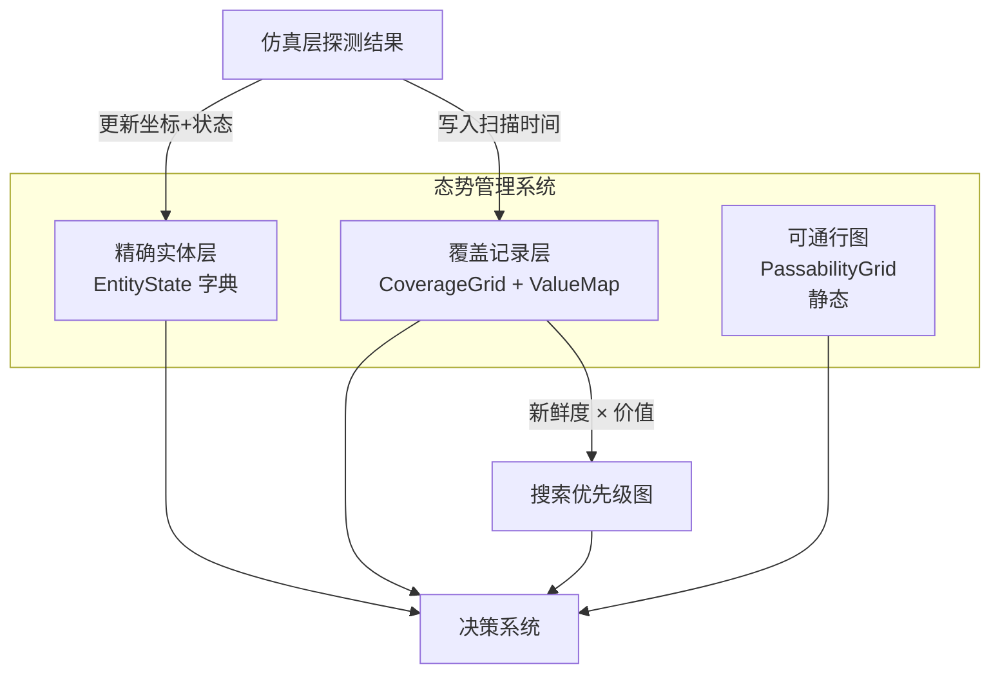
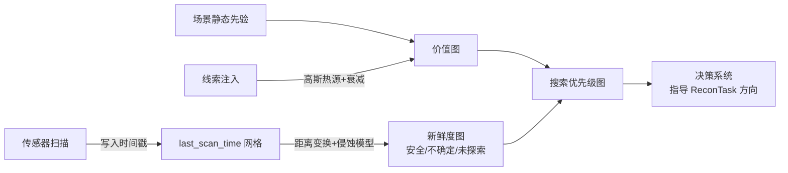
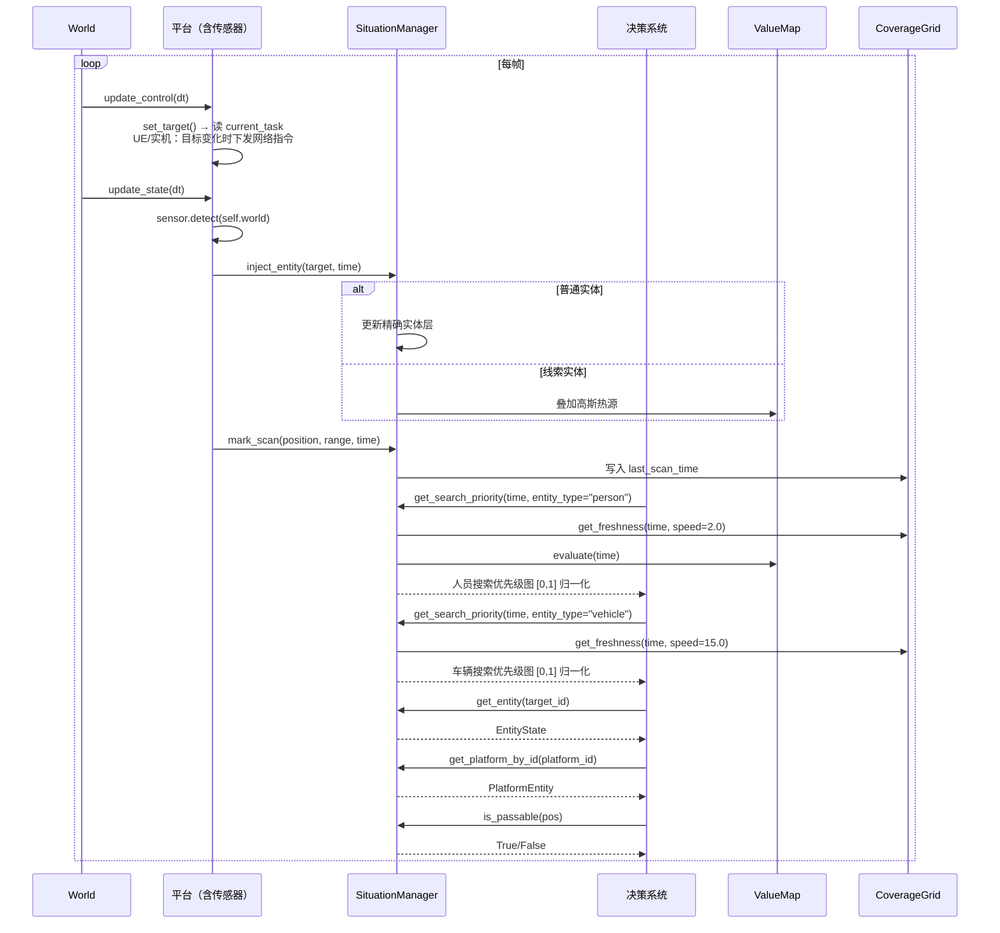

# 态势管理系统设计

## 1. 概述

态势管理系统维护我方视角下的世界认知，是所有决策和任务判定的信息基础。它与仿真器真值严格分离：只接收传感器探测结果，不驱动任何实体，不修改实体状态。

### 核心职责

| 职责 | 说明 |
|:---|:---|
| 维护已发现实体的精确状态副本 | 位置、速度、状态字段（injured / neutralized / repaired 等） |
| 维护空间覆盖记录 | 哪些区域已被传感器扫描、何时扫描的 |
| 维护搜索价值分布 | 结合场景先验和动态线索，表达"哪里更值得搜" |
| 提供搜索优先级图 | 综合覆盖新鲜度与价值分布，指导决策系统制定搜索策略 |
| 维护静态可通行图 | 供 UGV 路径规划使用，UAV 忽略 |

### 三层结构



**各场景使用的层**：

| | 精确实体层 | 覆盖记录层+价值图 | 可通行图 |
|:---|:---|:---|:---|
| 搜救 | 发现人员后记录坐标 | 全图均匀价值，指导搜索 | UGV 救援路径规划 |
| 边境巡检 | 越境者/车辆持续跟踪 | 边境线带状价值，指导持续巡逻 | UGV 巡逻+核查路径 |
| 区域封控 | 黑飞持续跟踪 | 外围入侵价值，指导预警区搜索 | UGV 围界巡逻路径 |

---

## 2. 精确实体层

维护所有 **已被态势层感知**（`discovered == True`）实体的状态副本。每个实体存储一份 `EntityState`，包含决策系统所需的最新认知信息。

### 2.1 EntityState

```python
@dataclass
class EntityState:
    entity_id: int                    # 全局唯一标识
    entity_type: str                  # "uav" / "ugv" / "victim" / "intruder" / ...
    position: tuple[float, float]     # 最新已知位置 (x, y)
    velocity: tuple[float, float]     # 最新已知速度 (vx, vy)
    timestamp: float                  # 该状态对应的仿真时刻
    discovered: bool                  # 是否已被态势层首次感知（始终为 True）
    
    # 类型特定的状态字段，用 extra 字典存储
    extra: dict                       # 例: {"injured": True, "rescued": False, ...}
```

### 2.2 接口

```python
class EntityStateLayer:
    """精确实体层：维护已发现实体的状态副本"""
    
    entities: dict[int, EntityState]  # entity_id → EntityState
    
    def update_entity(self, entity_id: int, pos, vel, time, **extra):
        """
        由仿真层每帧调用，更新实体状态。
        首次调用时自动设置 discovered = True（如果之前不存在）。
        已标记 rescued / neutralized 且 enabled=False 的实体不再更新。
        """
    
    def get_entity(self, entity_id: int) -> EntityState | None:
        """获取指定实体的态势认知"""
    
    def get_all_entities(self) -> dict[int, EntityState]:
        """获取所有已发现实体的态势认知"""
    
    def get_entities_by_type(self, entity_type: str) -> list[EntityState]:
        """按类型筛选实体"""
    
    def get_platforms(self) -> list[EntityState]:
        """获取所有己方平台（uav / ugv）的状态"""
    
    def get_targets(self) -> list[EntityState]:
        """获取所有已发现目标实体的状态"""
    
    def forget_entity(self, entity_id: int):
        """
        从态势层移除实体认知（仅仿真测试用）。
        正常流程中实体一旦 discovered，不会丢失。
        """
```

### 2.3 通信假设

本系统假设平台间通信正常，态势层实时接收所有探测结果。

---

## 3. 覆盖记录层

覆盖记录层回答两个问题：
- **哪片区域已被扫描过，扫描的有效期还剩多久？**（新鲜度图）
- **哪片区域更值得去搜？**（价值图）

两者叠加得到搜索优先级图，直接指导决策系统的搜索策略。



### 3.1 last_scan_time 网格

**存储层**：每个网格只存一个浮点数——最近一次被传感器扫描的仿真时刻。

```
网格数值含义：
  -inf     → 从未被扫描（未探索）
  0.0      → T=0 时刻被扫描过
  50.0     → T=50 时刻被扫描过
  100.0    → T=100 时刻被扫描过（刚扫过）
```

数据只在传感器扫过时写入，不随仿真推进自动变化。

```python
class CoverageGrid:
    """覆盖记录网格：记录每个网格的最近扫描时间"""
    
    def __init__(self, scene_width: float, scene_height: float, resolution: float = 50.0):
        self.resolution = resolution
        self.width = int(scene_width / resolution)
        self.height = int(scene_height / resolution)
        self.last_scan_time = np.full((self.height, self.width), -np.inf)
    
    def mark_scanned(self, position: tuple[float, float], sensor_range: float, time: float):
        """
        标记传感器覆盖范围内的网格为已扫描。
        
        参数：
            position: 传感器当前位置 (x, y)，米制坐标
            sensor_range: 传感器有效距离，米
            time: 当前仿真时刻
        """
        cx, cy = self._world_to_grid(position)
        radius_grid = int(sensor_range / self.resolution)
        
        # 对以 (cx, cy) 为中心、radius_grid 为半径的圆形区域写入当前时间
        for dy in range(-radius_grid, radius_grid + 1):
            for dx in range(-radius_grid, radius_grid + 1):
                if dx*dx + dy*dy <= radius_grid * radius_grid:
                    gx, gy = cx + dx, cy + dy
                    if 0 <= gx < self.width and 0 <= gy < self.height:
                        self.last_scan_time[gy, gx] = time
    
    def _world_to_grid(self, pos: tuple[float, float]) -> tuple[int, int]:
        """世界坐标 → 网格坐标"""
        return int(pos[0] / self.resolution), int(pos[1] / self.resolution)
```

### 3.2 新鲜度查询：侵蚀模型

新鲜度回答"这片已扫描过的区域，现在还安全吗"。

**核心思想**：未扫描区域是威胁的源头。一个目标以最快速度 `V` 移动，经过时间 `Δt` 后，最多能从未扫描区向内推进 `V × Δt` 米。已扫描区内任一网格，若其到最近未扫描网格的距离 ≤ `V × Δt`，则不再安全（可能已有目标进入）。

这并非传统卷积扩散（从已知向外推），而是 **未扫描区域向内侵蚀**，方向相反。实现上使用 `scipy.ndimage.distance_transform_edt` 计算每个已扫描网格到最近未扫描边界的欧氏距离，再与各网格的侵蚀半径（`max_target_speed × 经过时间`）做向量化比较，避免逐像素循环。

```python
def get_freshness(self, current_time: float, erosion_speed: float) -> np.ndarray:
    """
    查询当前新鲜度。

    同一个 last_scan_time 网格，用不同的 erosion_speed 可得到不同的新鲜度结论。
    调用方从场景配置的 erosion_speeds 表按实体类型获取速度后传入。

    返回三值网格（与 last_scan_time 同尺寸）：
        0 = 未探索 (never scanned)
        1 = 不确定 (eroded — 曾被扫描但可能已有目标进入)
        2 = 安全 (fresh — 曾被扫描且目标来不及抵达)

    参数：
        current_time: 当前仿真时刻
        erosion_speed: 该实体类型的最大移动速度（m/s），从场景配置 erosion_speeds 表获取
            - 人员 ≈ 2 m/s（几乎不侵蚀）
            - 车辆 ≈ 15 m/s
            - 黑飞 ≈ 18 m/s
    """
    from scipy.ndimage import distance_transform_edt

    scanned = np.isfinite(self.last_scan_time)

    if not np.any(scanned):
        # 全未探索 → 全部标记为 0
        return np.zeros_like(self.last_scan_time, dtype=np.int32)

    if np.all(scanned):
        # 全区域已被扫描，无未探索威胁源 → 全部安全（边界情况处理）
        return np.full_like(self.last_scan_time, 2, dtype=np.int32)

    # 距离变换：每个已扫描网格到最近未扫描边界的距离（网格单位）
    dist_to_unscanned_cells = distance_transform_edt(scanned.astype(np.float32))

    # 各网格的侵蚀半径（网格单位）：目标从最近一次扫描后最多能走多远
    age = np.maximum(current_time - self.last_scan_time, 0.0)
    erosion_radius_cells = erosion_speed * age / self.resolution

    # 向量化安全判定：已扫描 且 到未扫描边界距离 > 侵蚀半径
    safe = scanned & (dist_to_unscanned_cells > erosion_radius_cells)

    # 组装三值输出：0=未探索, 1=不确定(已扫描但侵蚀范围内), 2=安全
    result = np.zeros_like(self.last_scan_time, dtype=np.int32)
    result[scanned & (~safe)] = 1   # 已扫描但不安全 → 不确定
    result[safe] = 2                # 安全
    return result
```

**侵蚀模型与卷积扩散的对比**：

| | 卷积扩散（参考项目） | 侵蚀模型（本设计） |
|:---|:---|:---|
| 方向 | 从已知位置向外扩散概率 | 从未知区域向内侵蚀 |
| 结果 | 连续概率值 | 三值：安全 / 不确定 / 未探索 |
| 依赖 | 需要知道目标数量和初始位置 | 不依赖目标数量 |
| 计算量 | 每目标一次卷积 | 一次全局距离变换 |
| 最适场景 | 已知数量、间歇可见的移动目标 | 未知数量、持续搜索 |

**相同扫描记录、不同侵蚀速度下的新鲜度对比**：

同一个 `last_scan_time` 网格，用不同 `erosion_speed` 计算的新鲜度不同。
决策系统按实体类型分别查询，得到独立的"安全"判断。

```
人员 (erosion_speed=2 m/s):         车辆 (erosion_speed=15 m/s):
T=600s                              
┌──────────────────────┐           ┌──────────────────────┐
│ ?  ?  ?  ?  ?  ?  ? │           │ ?  ?  ?  ?  ?  ?  ? │
│ ?  U  U  U  U  U  ? │           │ ?  U  U  U  U  U  ? │
│ ?  U  S  S  S  S  ? │  vs       │ ?  U  U  U  U  U  ? │  安全区几乎消失
│ ?  ?  ?  ?  ?  ?  ? │           │ ?  ?  ?  ?  ?  ?  ? │
└──────────────────────┘           └──────────────────────┘
  ? = 未探索  U = 不确定  S = 安全   侵蚀半径大很多 → 必须持续巡逻
```

**三个场景下的典型表现**：

```
搜救 (erosion_speed≈2 m/s):
    人员几乎静止 → 扫描过的区域近乎永久安全
    ┌──────────────────────┐
    │ ?  ?  ?  ?  ?  ?  ? │
    │ ?  S  S  S  S  S  ? │  等价于 RTS 战争迷雾
    │ ?  S  S  S  S  S  ? │
    │ ?  ?  ?  ?  ?  ?  ? │
    └──────────────────────┘

边境巡检 (人员 2 m/s, 车辆 15 m/s → 车辆侵蚀快):
    对车辆的新鲜度图 → 10分钟后侵蚀半径 = 15×600 = 9km → 必须持续巡逻
    
区域封控 (黑飞 18 m/s → 侵蚀最快):
    但区域小(6×6km) + 多 UAV 高频扫描 → 可维持覆盖
```

### 3.3 价值图（Value Map）

价值图表达"目标更可能出现在哪里"，由静态先验和动态线索叠加组成。

```python
class ValueMap:
    """搜索价值图：静态先验 + 动态线索热源"""
    
    def __init__(self, scene_width: float, scene_height: float, resolution: float = 50.0):
        self.resolution = resolution
        self.width = int(scene_width / resolution)
        self.height = int(scene_height / resolution)
        self.base = np.zeros((self.height, self.width))  # 静态先验
        self.sources: list[CueSource] = []               # 动态线索热源列表
    
    def set_static_prior(self, prior_type: str, **params):
        """
        设置场景静态先验分布。
        
        prior_type 可选值：
            "uniform"       — 全图均匀（搜救）
            "border_decay"  — 沿边境线距离衰减（边境巡检）
            "perimeter_decay" — 从外围向内衰减（区域封控）
        """
    
    def inject_cue(self, position: tuple[float, float], radius: float,
                   confidence: float, time: float, half_life: float = 300.0):
        """
        注入动态线索，在价值图上叠加一个高斯热源。
        
        参数：
            position: 线索参考位置 (x, y)，米制坐标
            radius: 线索影响半径，米
            confidence: 置信度 [0, 1]
            time: 线索注入时刻
            half_life: 线索半衰期，秒（默认 5 分钟）
        """
        self.sources.append(CueSource(
            grid_pos=self._world_to_grid(position),
            sigma=radius / (2.0 * self.resolution),
            peak=confidence,
            born_time=time,
            half_life=half_life,
        ))
    
    def evaluate(self, current_time: float) -> np.ndarray:
        """
        评估当前时刻全图价值分布，返回归一化到 [0, 1] 的网格。
        静态先验 + 所有动态热源（含衰减）。
        """
        value = self.base.copy()
        
        for src in self.sources:
            age = current_time - src.born_time
            if age < 0:
                continue
            decay = 0.5 ** (age / src.half_life)
            if decay < 0.01:
                continue  # 衰减到可忽略，跳过
            
            # 在热源位置叠加高斯分布
            gx, gy = src.grid_pos
            sigma = src.sigma
            y_indices, x_indices = np.ogrid[:self.height, :self.width]
            gaussian = np.exp(-((x_indices - gx)**2 + (y_indices - gy)**2) / (2 * sigma**2))
            value += gaussian * src.peak * decay
        
        return np.clip(value, 0.0, 1.0)  # 截断到 [0, 1]
```

#### 静态先验的具体配置

```python
def set_static_prior(self, prior_type: str, **params):
    """设置场景静态先验分布"""
    
    if prior_type == "uniform":
        # 搜救：全图均匀分布，每个网格价值相等
        self.base = np.ones((self.height, self.width))
    
    elif prior_type == "border_decay":
        # 边境巡检：价值沿边境线距离线性衰减
        border_y = params.get("border_y", 0.0)       # 边境线 Y 坐标
        max_dist = params.get("max_dist", 12000.0)    # 最大衰减距离，米
        
        for gy in range(self.height):
            world_y = gy * self.resolution
            dist = abs(world_y - border_y)
            self.base[gy, :] = max(0.0, 1.0 - dist / max_dist)
    
    elif prior_type == "perimeter_decay":
        # 区域封控：价值从外边界向内衰减
        # 距离中心越远，价值越高（目标从外围侵入）
        center_x = params.get("center_x", 3000.0)
        center_y = params.get("center_y", 3000.0)
        max_radius = params.get("max_radius", 3000.0)  # 全高价值区域边界，米
        
        for gy in range(self.height):
            for gx in range(self.width):
                world_x = gx * self.resolution
                world_y = gy * self.resolution
                dist_to_center = np.sqrt((world_x - center_x)**2 + (world_y - center_y)**2)
                self.base[gy, gx] = min(1.0, dist_to_center / max_radius)
```

**各个场景的静态先验可视化**：

```
搜救 — uniform:
┌──────────────────┐
│ 1.0 1.0 1.0 1.0 │
│ 1.0 1.0 1.0 1.0 │  全图均等，配合新鲜度自然引导覆盖未探索区域
│ 1.0 1.0 1.0 1.0 │
│ 1.0 1.0 1.0 1.0 │
└──────────────────┘

边境巡检 — border_decay (border_y=0):
┌──────────────────┐
│ 1.0 0.8 0.6 0.4 │ ← 边境线，价值最高
│ 0.8 0.6 0.4 0.2 │
│ 0.6 0.4 0.2 0.0 │  距边境线越远，越境概率越低
│ 0.4 0.2 0.0 0.0 │
└──────────────────┘

区域封控 — perimeter_decay (中心在图中):
┌──────────────────┐
│ 1.0 1.0 1.0 1.0 │ ← 外围预警区，目标出现概率最高
│ 1.0 0.7 0.7 1.0 │
│ 1.0 0.7 0.7 1.0 │  越靠近核心区，新目标出现概率越低
│ 1.0 1.0 1.0 1.0 │  （目标到核心区直接拦截，不需搜索）
└──────────────────┘
```

#### 动态线索叠加效果

```
静态先验                    线索注入后                  5分钟后（衰减）
┌──────────────┐          ┌──────────────┐           ┌──────────────┐
│ 0.5 0.5 0.5 │          │ 0.5 0.5 0.5 │           │ 0.5 0.5 0.5 │
│ 0.5 0.5 0.5 │    +     │ 0.5 0.8 0.5 │    →      │ 0.5 0.6 0.5 │  + 号处
│ 0.5 0.5 0.5 │   线索   │ 0.8 1.0 0.8 │           │ 0.6 0.7 0.6 │  峰值消退
│ 0.5 0.5 0.5 │  (中央)  │ 0.5 0.8 0.5 │           │ 0.5 0.6 0.5 │
└──────────────┘          └──────────────┘           └──────────────┘
```

### 3.4 搜索优先级图

新鲜度图与价值图叠加，得到搜索优先级图，直接供决策系统使用。

```python
def get_search_priority(self, current_time: float, entity_type: str) -> np.ndarray:
    """
    返回按实体类型查询的搜索优先级图，归一化到 [0, 1]。
    内部从场景配置 erosion_speeds 表获取该类型的侵蚀速度。
    
    计算逻辑：
        priority = value × unsafe_mask
        其中 unsafe_mask: 非安全区域 = 1, 安全区域 = 0
    
    安全区域不需要搜索（已扫描且该类型目标来不及进入），优先级强制为 0。
    """
    speed = self.world.config.erosion_speeds.get(entity_type, 0.0)
    freshness = self.coverage.get_freshness(current_time, speed)
    value = self.value_map.evaluate(current_time)
    
    # 安全区域（freshness == 2）优先级为 0
    unsafe_mask = (freshness != 2).astype(np.float64)
    
    priority = value * unsafe_mask
    return priority
```

决策系统使用方式：

```python
# 在决策系统中，按实体类型分别查询优先级图
erosion_speeds = self.world.config.erosion_speeds

# 为每种关注的目标类型生成独立的优先级图
for entity_type in erosion_speeds:
    priority_map = situation.get_search_priority(current_time, entity_type)

    # 查找该类型的高优先级区域
    max_idx = np.unravel_index(np.argmax(priority_map), priority_map.shape)
    target_pos = (max_idx[1] * resolution, max_idx[0] * resolution)

    # 线索指向特定实体类型时，只查对应类型的优先级图
    if cue and cue.target_entity_type == entity_type:
        regions = extract_high_priority_regions(priority_map, threshold=0.3)
        for region in regions[:available_uav_count]:
            assign_recon_task(region, entity_type)
```

---

## 4. 可通行图

静态地形数据，由场景加载时预计算生成，供 UGV 路径规划使用。UAV 忽略此图（飞行无视地形障碍）。

```python
class PassabilityGrid:
    """静态可通行图：标记地形是否可通行"""
    
    GRID_PASSABLE = 0      # 可通过
    GRID_OBSTACLE = 1      # 障碍物（陡崖、水体、建筑等）
    GRID_ROAD = 2          # 道路（通行成本最低）
    
    def __init__(self, scene_config: "SceneConfig"):
        """
        根据场景配置生成可通行图。
        三种生成方式：
            1. 从地形数据文件加载
            2. 从障碍多边形列表生成
            3. 全可通行（最简单的测试场景）
        """
        self.width = int(scene_config.width / scene_config.resolution)
        self.height = int(scene_config.height / scene_config.resolution)
        self.resolution = scene_config.resolution
        self.grid = np.zeros((self.height, self.width), dtype=np.int32)
        
        # 从障碍列表填充
        for obstacle in scene_config.obstacles:
            self._fill_obstacle(obstacle)
        
        # 从道路列表填充
        for road in scene_config.roads:
            self._fill_road(road)
    
    def is_passable(self, pos: tuple[float, float]) -> bool:
        """判断指定世界坐标是否可通行"""
        gx, gy = self._world_to_grid(pos)
        if not (0 <= gx < self.width and 0 <= gy < self.height):
            return False
        return self.grid[gy, gx] != GRID_OBSTACLE
    
    def get_move_cost(self, pos: tuple[float, float]) -> float:
        """
        获取通行成本。道路成本最低，普通地形中等，障碍物不可通行。
        UAV 始终返回 1.0（忽略地形）。
        """
        gx, gy = self._world_to_grid(pos)
        if not (0 <= gx < self.width and 0 <= gy < self.height):
            return float('inf')
        if self.grid[gy, gx] == GRID_ROAD:
            return 1.0       # 道路最优
        elif self.grid[gy, gx] == GRID_PASSABLE:
            return 3.0       # 普通地形
        else:
            return float('inf')  # 不可通行
```
```

---

## 5. 统一接口

```python
class SituationManager:
    """
    态势管理器：整合三层态势数据的统一入口。
    仿真层通过 inject_entity() 推送探测结果，决策系统通过查询接口读取态势。
    在真实部署中，平台传感器探测结果的推送方式与仿真完全一致。
    """
    
    def __init__(self, world: "World"):
        # 持有 World 引用以查询全局配置（侵蚀速度表等）
        self.world = world
        
        self.scene_width = world.config.width
        self.scene_height = world.config.height
        self.resolution = world.config.resolution
        
        # 三层态势
        self.entities = EntityStateLayer()
        self.coverage = CoverageGrid(self.scene_width, self.scene_height, self.resolution)
        self.value_map = ValueMap(self.scene_width, self.scene_height, self.resolution)
        self.passability = PassabilityGrid(world.config)
        
        # 我方平台直接索引：platform_id → PlatformEntity（供快速查找）
        self.platforms: dict[int, "PlatformEntity"] = {}
        
        # 初始化价值图静态先验
        prior_config = world.config.value_prior
        self.value_map.set_static_prior(**prior_config)
    
    # === 注入接口（仿真层 / 真实传感器调用） ===
    
    def inject_entity(self, entity, time: float):
        """
        将传感器探测到的实体推入态势层，根据实体类型自动分流处理。
        
        - TargetEntity / PlatformEntity → 更新精确实体层（坐标、速度、状态字段）
        - CueEntity            → 注入 ValueMap 高斯热源
        """
        if entity.entity_type == "cue":
            # 线索实体 → 注入价值图热源
            self.value_map.inject_cue(
                position=entity.position,
                radius=entity.radius,
                confidence=entity.confidence,
                time=time,
            )
        else:
            # 普通实体（平台、目标） → 更新精确实体层
            self.entities.update_entity(
                entity.id, entity.position, entity.velocity, time,
                **self._extract_extra(entity),
            )
    
    def register_platform(self, platform: "PlatformEntity"):
        """World 在 add_entity 时调用：将己方平台注册到态势层直接索引中"""
        self.platforms[platform.id] = platform
    
    def unregister_platform(self, platform_id: int):
        """平台移除时从直接索引中删除"""
        self.platforms.pop(platform_id, None)
    
    def mark_scan(self, position, sensor_range, time):
        """
        仿真层调用：记录传感器空间覆盖。
        真实部署中等效于记录平台传感器扫过的区域。
        """
        self.coverage.mark_scanned(position, sensor_range, time)
    
    def _extract_extra(self, entity) -> dict:
        """从实体真值中提取决策系统关心的状态字段"""
        extra = {}
        for field in ("injured", "neutralized", "repaired", "rescued",
                       "debris_cleared", "received_supply", "verified",
                       "battery", "stock"):
            if hasattr(entity, field):
                extra[field] = getattr(entity, field)
        return extra
    
    # === 查询接口（决策系统调用） ===
    
    def get_entity(self, entity_id):
        """获取指定实体的态势认知"""
        return self.entities.get_entity(entity_id)
    
    def get_all_targets(self):
        """获取所有已发现目标"""
        return self.entities.get_targets()
    
    def get_platforms(self):
        """获取所有己方平台状态"""
        return self.entities.get_platforms()
    
    def get_platform_by_id(self, platform_id: int) -> "PlatformEntity | None":
        """通过 ID 直接获取平台实体实例（O(1)，比遍历快）"""
        return self.platforms.get(platform_id)
    
    # === 覆盖记录层 ===
    
    def get_search_priority(self, current_time, entity_type):
        """决策系统调用：按实体类型获取搜索优先级图。内部从 world 配置 erosion_speeds 表查速度。"""
        return self._compute_priority(current_time, entity_type)
    
    # === 可通行图 ===
    
    def is_passable(self, pos):
        """决策系统/平台调用：判断可通行性"""
        return self.passability.is_passable(pos)
    
    def get_move_cost(self, pos):
        """决策系统/平台调用：获取通行成本"""
        return self.passability.get_move_cost(pos)
    
    # === 内部计算 ===
    
    def _compute_priority(self, current_time, entity_type):
        """内部：计算指定实体类型的搜索优先级图"""
        speed = self.world.config.erosion_speeds.get(entity_type, 0.0)
        freshness = self.coverage.get_freshness(current_time, speed)
        value = self.value_map.evaluate(current_time)
        unsafe_mask = (freshness != 2).astype(np.float64)
        return value * unsafe_mask
```

---

## 6. 与仿真层的交互

态势层不直接访问仿真真值。每帧，平台在 `update_state()` 中调用自身传感器的 `detect()`，然后将探测结果推送给态势层：

```python
# 平台 PlatformEntity.update_state() 中
def update_state(self, dt):
    # ... 执行任务行为 ...
    
    # 传感器探测：传感器自身查询周围实体
    sensor = self.get_capability("sensor")
    if sensor is not None:
        detected = sensor.detect(self.world)  # 传感器内部通过 self.world 获取附近实体
        
        # 推送探测结果到态势层
        for target in detected:
            self.world.situation.inject_entity(target, time=self.world.time)
        
        # 记录空间覆盖
        self.world.situation.mark_scan(self.position, sensor.range, self.world.time)
```

`tick()` 的完整定义见 [场景与世界模型设计 §3.4](场景与世界模型设计.md#34-每帧驱动tick)。态势层在此流程中的参与点是步骤 5：平台在 `update_state()` 中调用 `sensor.detect()` 后将结果推入态势层。

> **真实部署兼容性**：态势层只知道 `inject_entity()` 和 `mark_scan()` 两个入口，不依赖 World 的内部实现。真实部署时，平台传感器同样调用这两个方法推送探测结果。

---

## 7. 场景配置速查

### 7.1 搜救场景

```python
scene_config = {
    "width": 10000, "height": 10000, "resolution": 50,
    
    # 侵蚀速度表：实体类型 → 最大速度(m/s)
    "erosion_speeds": {"person": 2.0},
    
    "value_prior": {
        "prior_type": "uniform",
    },
    
    # 简单场景：障碍物较少
    "obstacles": [
        # 陡崖区、干涸沟壑等不可通行地形
    ],
    "roads": [],
}
```

- `erosion_speeds` 仅包含人员(2.0 m/s)，人员几乎静止，侵蚀几乎不生效
- 价值图全图均匀 → 单纯按未探索区域搜索

### 7.2 边境巡检场景

```python
scene_config = {
    "width": 12000, "height": 12000, "resolution": 50,
    
    # 侵蚀速度表：两种目标类型
    "erosion_speeds": {"person": 2.0, "vehicle": 15.0},
    
    "value_prior": {
        "prior_type": "border_decay",
        "border_y": 0.0,
        "max_dist": 12000.0,
    },
    
    "obstacles": [
        # 山地林区、河谷沟壑
    ],
    "roads": [
        # 巡逻道路网络
    ],
}
```

- `erosion_speeds` 包含人员(2.0 m/s)与车辆(15.0 m/s) → 车辆侵蚀快，需持续巡逻
- 价值图沿边境线衰减 → 边境附近优先扫描
- 线索注入：固定哨点报告异常 → 在价值图上叠加热源

### 7.3 区域封控场景

```python
scene_config = {
    "width": 6000, "height": 6000, "resolution": 50,
    
    # 侵蚀速度表
    "erosion_speeds": {"aerial": 18.0},
    
    "value_prior": {
        "prior_type": "perimeter_decay",
        "center_x": 3000.0,
        "center_y": 3000.0,
        "max_radius": 3000.0,
    },
    
    "obstacles": [
        # 机场围界、建筑、跑道净空区
    ],
    "roads": [
        # 围界道路
    ],
}
```

- `erosion_speeds` 仅包含黑飞(18.0 m/s) → 最快的侵蚀速度
- 价值图外围高、中心低 → 重点搜索外围预警区
- 线索注入：固定感知节点粗告警 → 在告警方向叠加高斯热源

---

## 8. 数据流总结


