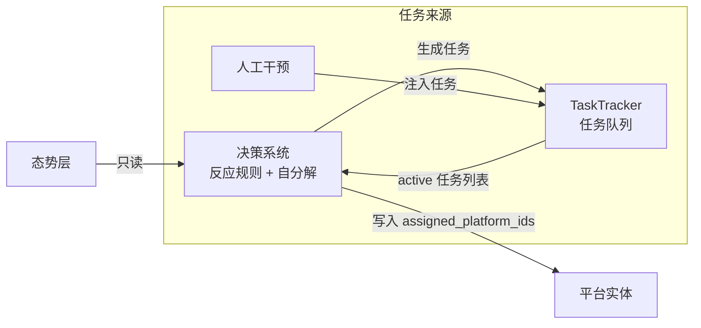
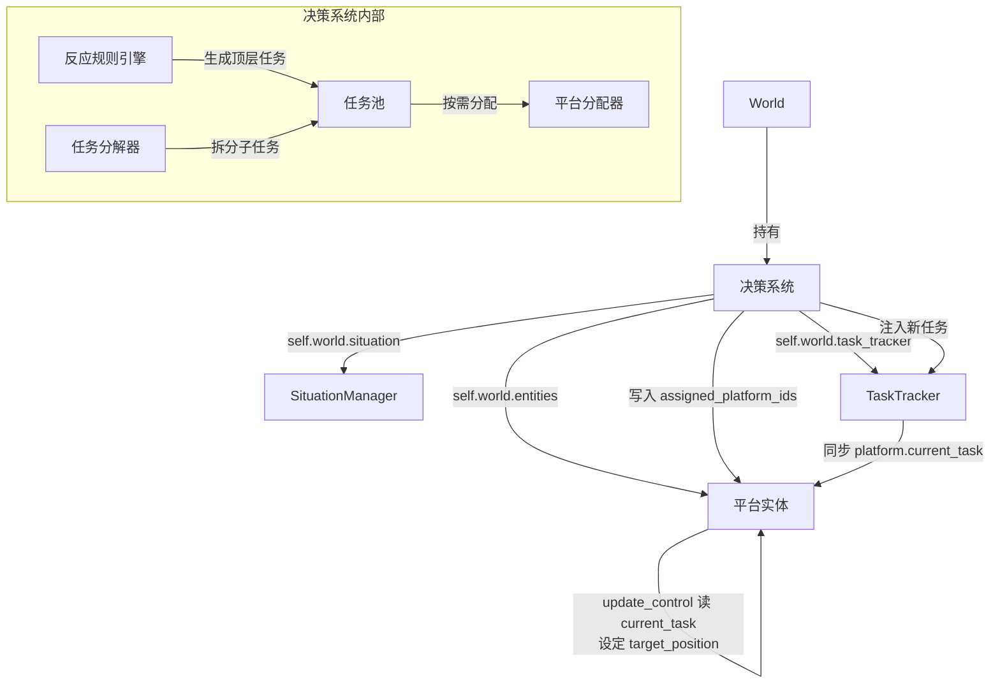
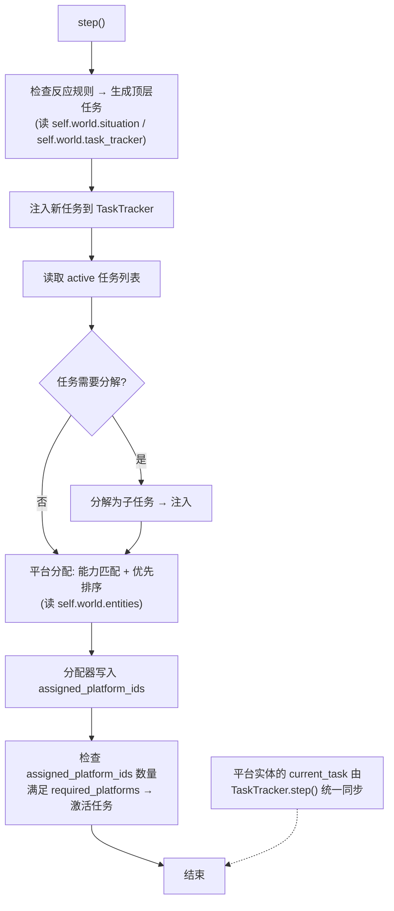

# 指挥与决策系统设计

## 1. 概述

决策系统是异构无人协同指控系统的核心智能组件。它持有 `world` 引用，通过 `self.world.situation` 和 `self.world.task_tracker` 访问态势和任务，负责"何时该做什么、由谁来做"。决策系统在仿真和真实部署中代码完全一致。

```python
class DecisionSystem:
    """决策系统：通过 world 引用访问态势层、任务跟踪器和平台列表。
    
    构造时从 world.config 读取反应规则。初始任务由 World 通过 task_schedule 注入。
    """
    
    def __init__(self, world: "World"):
        self.world = world
        self.rules = world.config.reaction_rules
        self.allocator = PlatformAllocator()
        self.decomposer = TaskDecomposer()
```

三层任务来源均汇入 TaskTracker 的任务队列：



### 核心职责

| 职责 | 说明 |
| :--- | :--- |
| **态势感知** | 读取态势层，了解当前世界认知和平台状态 |
| **反应规则** | 根据态势变化，决定何时生成新任务（"发现伤员 → 投送急救包"） |
| **任务分解** | 将顶层任务拆解为可执行的子任务（"救援 → 先搜索 → 再投送 → 再救援"） |
| **平台分配** | 根据任务 `required_capabilities` 和平台能力、位置、电量匹配平台 |

决策系统止于任务分配。平台收到任务后，**自己根据任务类型和自身能力生成控制指令**（如何扫描区域、如何抵近目标、如何降落充电）。决策系统不关心平台的底层运动控制细节。


## 2. 架构



**每帧执行流程**（`step()` 无参，通过 `self.world` 访问态势和任务）：




## 3. 反应规则

反应规则定义"当态势层出现某种变化时，应当生成什么任务"。规则只读态势层和已有任务，不碰实体真值，仿真和真实部署中完全一致。

> **说明**：以下代码为接口定义和示例占位。反应规则的具体触发条件、去重逻辑、批量生成策略等属于决策系统的详细设计范畴，将在实现阶段细化。

### 3.1 规则基类

```python
class ReactionRule(ABC):
    """反应规则基类。每帧检查态势和已有任务，决定是否生成新任务。
    
    分为两个阶段，均为纯函数（无副作用）：
        1. find_triggered() — 找出所有满足触发条件的态势实体
        2. generate()      — 根据触发的实体生成新任务列表
    """
    
    @abstractmethod
    def find_triggered(self, situation, active_tasks: dict[int, Task]) -> list:
        """查找态势层中满足触发条件的实体状态列表（纯查询，无副作用）。
        
        Returns:
            触发该规则的 EntityState 列表，空列表表示未触发。
        """
        pass
    
    @abstractmethod
    def generate(self, triggered: list, situation) -> list[Task]:
        """根据触发实体生成新任务列表。
        
        Args:
            triggered: find_triggered() 返回的触发实体列表
            situation: 态势管理器引用
        Returns:
            新生成的任务列表
        """
        pass
```

**step() 中的调用方式**（决策系统内部）：

```python
def _evaluate_rules(self):
    """评估所有反应规则，生成新任务"""
    situation = self.world.situation
    active_tasks = self.world.task_tracker.get_active()
    
    for rule in self.rules:
        triggered = rule.find_triggered(situation, active_tasks)
        if triggered:
            new_tasks = rule.generate(triggered, situation)
            for task in new_tasks:
                self.world.task_tracker.inject(task)
```

### 3.2 内置规则

| 规则 | 触发条件（态势层） | 生成任务 |
| :--- | :--- | :--- |
| `PersonDiscoveredRule` | victim 类型实体 `discovered` 变为 True，且无对应激活任务 | MedicalDeliveryTask（injured）或 RescueTask（非 injured） |
| `InjuryHandledRule` | victim 的 `injured` 从 True 变为 False，且无对应 RescueTask | RescueTask |
| `HostileTargetRule` | intruder / hostile_uav 类型实体 `discovered` 变为 True，且无对应 InterceptTask | InterceptTask |
| `FacilityAnomalyRule` | facility 类型实体 `discovered` 变为 True，`repaired` 为 False | RepairTask |
| `LowBatteryRule` | UAV 实体 `battery` 低于阈值（如 20%），且无对应 ChargeTask | ChargeTask |
| `LandingSiteRule` | hostile_uav 的 `neutralized` 变为 True，`debris_cleared` 为 False，且无对应 ClearTask | ClearTask（残骸清理） |

### 3.3 与态势层的交互

规则的 `should_fire()` **只查询态势层**的 EntityState，通过 `extra` 字段获取实体状态推断信息：

```python
class PersonDiscoveredRule(ReactionRule):
    """人员发现规则：当态势层出现新发现的victim且无对应激活任务时，生成处置任务"""
    
    def find_triggered(self, situation, active_tasks):
        """查找所有新发现且无对应激活任务的victim实体"""
        triggered = []
        for state in situation.get_all_entities().values():
            if state.entity_type != "victim":
                continue
            if not state.discovered:
                continue
            # 检查是否已有针对此人的激活任务
            if self._has_active_task_for(state.id, active_tasks):
                continue
            triggered.append(state)
        return triggered
    
    def generate(self, triggered, situation):
        """为每个触发实体生成对应的处置任务"""
        tasks = []
        for state in triggered:
            injured = state.extra.get("injured", False)
            if injured:
                tasks.append(MedicalDeliveryTask(target_entity_id=state.id))
            else:
                tasks.append(RescueTask(target_entity_id=state.id))
        return tasks
```

### 3.4 场景配置

场景配置中通过 `task_schedule` 声明任务日程表（T=0 即初始任务），与 `spawn_schedule` 模式一致，后续时刻用于模拟人工干预：

```python
# 搜救场景
scene_config = SceneConfig(
    task_schedule=[
        (0.0, ReconTask(area=任务区域, required_coverage=0.90)),
        (30.0, ArriveTask(target_pos=(5000, 2000))),  # 模拟人工干预
    ],
    reaction_rules=[
        PersonDiscoveredRule(),
        InjuryHandledRule(),
        LowBatteryRule(threshold=0.2),
    ],
)

# 边境巡检场景
scene_config = SceneConfig(
    task_schedule=[
        (0.0, ReconTask(area=边境线, required_coverage=0.95)),
    ],
    "reaction_rules": [
        HostileTargetRule(),
        FacilityAnomalyRule(),
        LowBatteryRule(threshold=0.2),
    ],
)
```


## 4. 任务分解

> **说明**：以下为任务分解的接口定义和示例占位。具体的分解策略、子任务依赖管理、冲突检测等属于详细设计范畴，将在实现阶段细化。

当决策系统判断一个 active 任务无法直接完成时，将其分解为子任务链：

| 顶层任务 | 分解后的子任务（按序） |
| :--- | :--- |
| RescueTask（人员位置未知） | ReconTask（子区域搜索）→ RescueTask |
| RescueTask（人员受伤） | MedicalDeliveryTask → RescueTask |
| InterceptTask（目标未发现） | ReconTask（在目标预判区域搜索）→ InterceptTask |

分解逻辑由决策系统内部维护，子任务也注入 TaskTracker 统一管理：

```python
class TaskDecomposer:
    """任务分解器（示例占位，详细分解策略待实现）"""
    
    def decompose(self, task: Task, situation) -> list[Task]:
        if isinstance(task, RescueTask):
            entity = situation.get_entity(task.target_entity_id)
            if entity is None or not entity.discovered:
                # 人员尚未发现，生成搜索子任务
                return [ReconTask(area=推断搜索区域)]
            if entity.extra.get("injured", False) and not self._has_completed_medical(task):
                # 受伤但未投送
                return [MedicalDeliveryTask(target_entity_id=task.target_entity_id)]
        return []  # 无需分解，或已可执行
```


## 5. 平台分配

> **说明**：以下为平台分配的接口定义和示例占位。具体的分配算法（匈牙利算法/贪心/拍卖）、多目标优化（距离+电量+任务负载）、在线重分配策略等属于详细设计范畴，将在实现阶段细化。

决策系统根据任务需求和平台状态进行分配：

```python
class PlatformAllocator:
    """平台分配器（示例占位，详细分配算法待实现）

    分配时仅写入 task.assigned_platform_ids。
     platform.current_task 由 TaskTracker.step() 在每帧末尾统一同步，
     分配器不直接操作平台实体的 current_task 字段。
    任务激活（pending → active）由决策系统在 _allocate_tasks 中统一处理。
    """

    def allocate(self, tasks: list[Task], platforms: list[PlatformEntity]):
        """为待分配任务匹配平台，写入 assigned_platform_ids"""

        # 按优先级排序任务
        sorted_tasks = sorted(tasks, key=lambda t: t.priority)

        for task in sorted_tasks:
            # 筛选满足能力需求且空闲（current_task 为空）的平台
            candidates = [
                p for p in platforms 
                if p.current_task is None
                and all(p.has_available_capability(c) for c in task.required_capabilities)
            ]
            if len(candidates) >= task.required_platforms:
                # 选择最佳匹配：距离最近、电量充足优先
                selected = sorted(
                    candidates, 
                    key=lambda p: p.distance_to(task.target)
                )[:task.required_platforms]

                for platform in selected:
                    task.assigned_platform_ids.append(platform.id)

# 决策系统 _allocate_tasks 中激活任务：
for task in pending_tasks:
    if len(task.assigned_platform_ids) >= task.required_platforms:
        self.world.task_tracker.activate_task(task.task_id)

    # 注意：一个任务可分配给多个平台（如 InterceptTask 的合围），
    # 每个被分配的平台都持有同一个 task 对象的引用
```

> **完成判定不在平台侧**：任务完成后由 TaskTracker 的 `step()` 统一判定，`_sync_platform_current_task()` 根据 `assigned_platform_ids` 将终态任务的平台 `current_task` 自动清空。平台在 `update_control` 中只负责根据 `current_task` 导航，不自行修改任务状态。


## 6. 平台执行

平台通过 `self.current_task` 读取被分配的任务，在 `update_control(dt)` 中决定意图（target_position），`update_movement(dt)` 中执行位移（仅 Python），`update_state(dt)` 中处理感知和状态。决策系统不关心中间的运动控制细节。

**平台不自行修改任务状态**：所有任务的完成判定由 TaskTracker（裁判系统）的 `step()` 统一执行，任务终态时 `_sync_platform_current_task()` 自动将对应平台 `current_task` 清空。平台只负责根据 `current_task` 导航到目标位置，不判断任务是否完成。

详细的任务→行为映射见 [实体与能力系统设计 §3.2](实体与能力系统设计.md#32-行为更新)。


## 7. 人工干预

指控系统提供人工干预接口，操作员可直接向 TaskTracker 注入任务。人工注入的任务与决策系统生成的任务同等对待，决策系统同样为其分配平台和生成指令。

| 操作 | 说明 |
| :--- | :--- |
| 注入任务 | 向 TaskTracker 注入任意类型任务（Arrive / Occupy / EntityTask 子类等） |
| 批量注入 | 注入一组关联任务，group_id 供决策系统按组处理 |
| 取消任务 | 取消 pending 或 active 状态的任务 |
| 调整优先级 | 修改已有任务的 priority |

人工注入的任务默认优先级较高（10），会优先于决策系统自动生成的任务获得平台分配。
