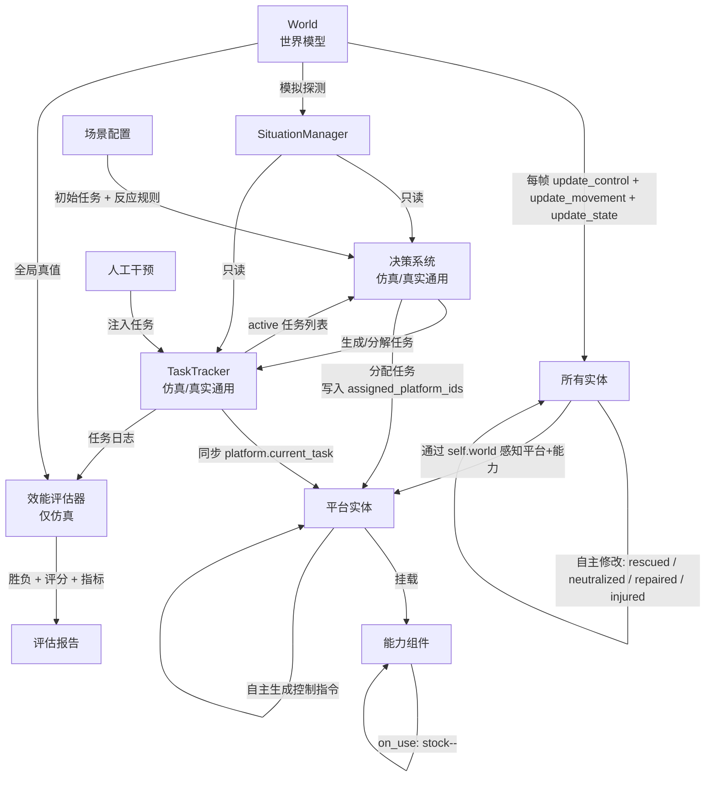
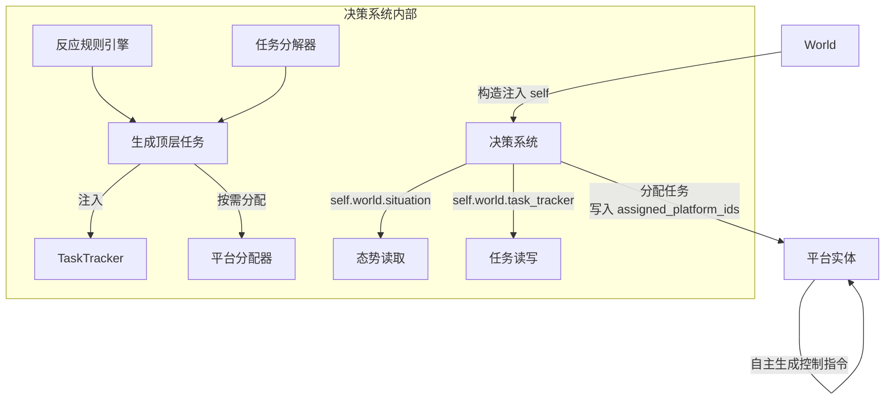
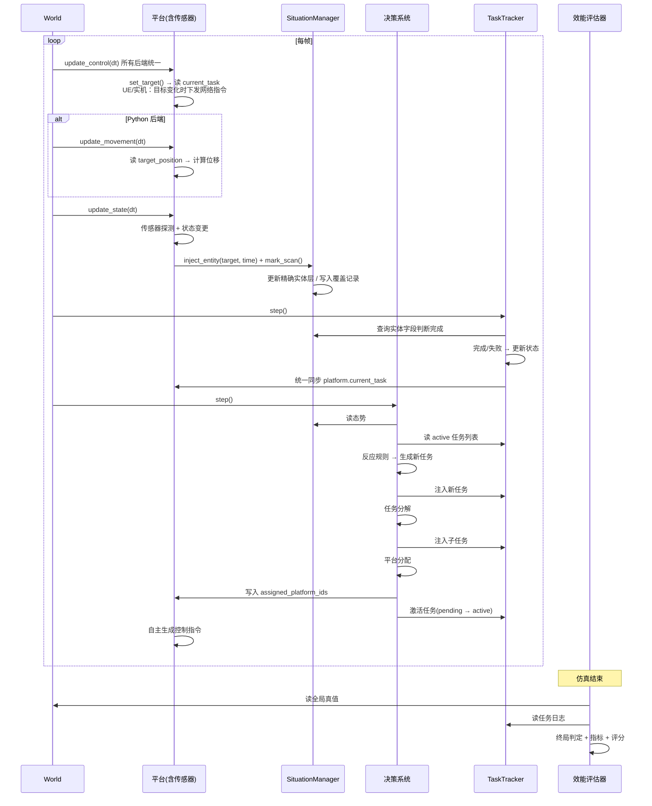

# 异构无人协同指控系统

## 一、概述

本系统面向三个典型应用场景（边境巡检、区域封控、搜救），采用统一的仿真与指控框架。三个场景共享实体模型、态势管理、任务跟踪、决策调度和效能评估逻辑，差异通过配置参数和反应规则表达。

系统分为五层：

- **仿真层**：维护世界真值，驱动所有实体运动与状态变更，执行传感器探测（仅仿真）。
- **态势层**：维护我方视角下的世界认知，是决策和任务判定的信息基础。
- **任务跟踪层**（TaskTracker）：纯任务生命周期管理器（裁判系统）——接收注入、跟踪状态、判定完成、任务终态释放已分配平台。不生成任务。
- **决策层**：指控系统核心。读取态势和任务队列，按反应规则生成新任务、分解子任务、分配平台、下达任务。控制指令由平台在收到任务后自主生成。
- **效能评估层**（Evaluator）：基于全局真值做终局胜负判定和指标统计（仅仿真）。

### 核心设计原则

**实体自己变自己，决策系统生成任务，TaskTracker 管理生命周期，评估器基于真值。**




## 二、实体与能力

所有可感知对象统一为实体（Entity），采用继承体系。每个实体具备 `update_control(dt)` / `update_movement(dt)` / `update_state(dt)` 方法，由 World 每帧调用。

平台统一为 **UAV（多旋翼）**和 **UGV（无人车）**，通过挂载不同能力（Capability）区分角色：

| 能力 | 说明 | 适用平台 |
| :--- | :--- | :--- |
| sensor | 侦察探测 | UAV, UGV |
| medical | 急救包投送（消耗型） | UAV |
| maintenance | 设施维修（消耗型） | UAV, UGV |
| charger | 无人机换电（消耗型） | UGV |
| effector | 目标拦截处置（消耗型） | UAV |
| cargo | 人员/物资运输 | UGV |
| debris_clear | 残骸清理 | UGV |

详见 [实体与能力系统设计](实体与能力系统设计.md)。


## 三、态势管理

态势层维护我方视角下的世界认知，与仿真器真值分离。它不驱动任何实体，只接收探测结果并更新认知。决策系统和 TaskTracker 均只读态势层。

态势层采用三层结构：

- **精确实体层**：维护已发现实体的精确坐标、速度、状态字段
- **覆盖记录层**：记录每个网格的传感器扫描历史，结合侵蚀模型生成新鲜度图；叠加静态先验和动态线索构成价值图；两者乘积得到搜索优先级图
- **可通行图**：静态地形数据，供 UGV 路径规划（UAV 忽略）

详见 [情报与态势系统设计](情报与态势系统设计.md)。


## 四、TaskTracker（任务跟踪器）

任务跟踪器是任务的**纯生命周期管理器**（裁判系统）。它不生成任务——"该做什么"由决策系统决定。所有任务的完成均由裁判系统统一判定，`platform.current_task` 也由 TaskTracker 每帧统一同步。

| 操作 | 调用方 | 说明 |
| :--- | :--- | :--- |
| `inject(task)` | 决策系统 / 人工 | 注入新任务，状态 = pending |
| `cancel(task_id)` | 人工 | 取消任务（pending/active → cancelled），同步时自动清空 platform.current_task |
| `get_active()` | 决策系统 | 返回 pending + active 任务列表 |
| `step()` | World | 每帧检查完成条件和超时（裁判系统判定），末尾统一同步 platform.current_task |

任务类型包括 ReconTask、EntityTask（Discover / MedicalDelivery / Rescue / Intercept / Repair / Charge）、ArriveTask、OccupyTask。所有任务的完成判定均由 TaskTracker 的 `step()` 统一执行，平台不自行修改任务状态。

详细设计见 [任务跟踪器设计](任务与裁判系统设计.md)。


## 五、决策系统

决策系统是指控核心。它持有 `world` 引用，通过 `self.world.situation` 和 `self.world.task_tracker` 访问态势和任务。仿真和真实部署代码完全一致。



每帧执行：

1. **反应规则**：检查态势变化，生成新任务注入 TaskTracker
2. **任务分解**：对 active 任务中无法直接执行的，拆分为子任务链
3. **平台分配**：按优先级和能力需求，为可执行任务匹配平台，写入 `assigned_platform_ids`。`platform.current_task` 由 TaskTracker 在每帧 step() 末尾统一同步，满足条件后在 TaskTracker 中激活任务

详细设计见 [指挥与决策系统设计](指挥与决策系统设计.md)。


## 六、World（世界模型）

World 管理实体生命周期并驱动每帧循环。它持有所有子系统引用，在 `tick()` 中按序调用。在真实部署中，平台位置由 Bridge 同步、传感器由真实设备替代，但 `update_control` 和 `update_state` 逻辑不变。详细设计见 [场景与世界模型设计](场景与世界模型设计.md)。

```python
def tick(self):
    # 1. 按时间线加入到期实体
    self._spawn_due_entities()
    
    # 2. 后端同步（UE / 实机：从外部拉取平台位置）
    if self._bridge is not None:
        self._bridge.sync_from_backend(self)
    
    # 3. 控制决策（所有后端统一：根据 current_task 决定 target_position）
    #    UE / 实机后端：set_target() 内部检测目标变化时自行下发网络指令
    for entity in list(self.entities.values()):
        if entity.enabled:
            entity.update_control(self.dt)
    
    # 4. 运动执行（仅 Python 后端：headless / matplotlib）
    if self._bridge is None:
        for entity in list(self.entities.values()):
            if entity.enabled:
                entity.update_movement(self.dt)
    
    # 5. 实体状态（所有后端统一）
    #    平台在 update_state() 中调用自身 sensor → situation.inject_entity()
    for entity in list(self.entities.values()):
        if not entity.enabled:
            continue
        entity.update_state(self.dt)

    # 6. TaskTracker 检查 active 任务完成条件，同步 platform.current_task
    self.task_tracker.step()

    # 7. 决策系统: 反应规则 + 分解 + 分配（写入 assigned_platform_ids）
    self.decision_system.step()
    
    self.time += self.dt
```


## 七、效能评估器（仅仿真）

基于全局真值做终局判定和指标统计。仿真结束时调用。

详见 [任务跟踪器设计 第5节](任务与裁判系统设计.md#5-效能评估器evaluator仅仿真)。


## 八、完整数据流




## 九、文档索引

| 文档 | 内容 |
| :--- | :--- |
| [场景与世界模型设计](场景与世界模型设计.md) | SceneConfig、World 类、实体生命周期、后端抽象（Matplotlib/Headless/UE/实机） |
| [实体与能力系统设计](实体与能力系统设计.md) | 实体继承体系、能力组件、实体自主行为 |
| [情报与态势系统设计](情报与态势系统设计.md) | 精确实体层、覆盖记录层、侵蚀模型、价值图、搜索优先级图、可通行图 |
| [任务与裁判系统设计](任务与裁判系统设计.md) | 任务类型、生命周期、完成判定、效能评估 |
| [指挥与决策系统设计](指挥与决策系统设计.md) | 反应规则、任务分解、平台分配、下达任务 |
| [场景设计-人员搜救](场景设计-人员搜救.md) | 荒野搜救场景定义 |
| [场景设计-边境巡检](场景设计-边境巡检.md) | 边境巡检场景定义 |
| [场景设计-区域封控](场景设计-区域封控.md) | 机场反无场景定义 |
