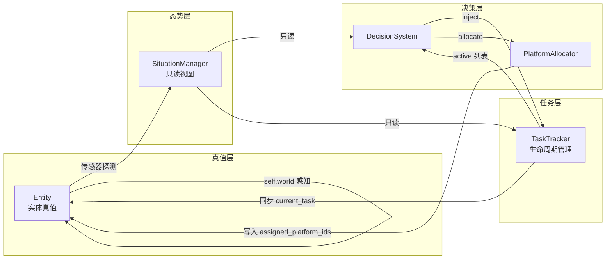

# AGENTS.md — 编码智能体指南

> 本文档面向编码智能体，聚焦**层职责边界**和**反模式**，避免重复 `.docs/` 设计文档中已有的详细设计说明。

***

## 一、层架构与职责边界



### 各层允许 / 禁止操作速查

| 层 | 允许 | 禁止 |
|---|---|---|
| **Entity** (update_state / update_control) | 通过 `self.world` 感知周围；修改**自身**状态字段；读取 `self.current_task`（执行用） | 修改其他实体状态；修改 `self.current_task.status`（完成由 TaskTracker 判定，不是实体自己说了算）；修改 `current_task.assigned_platform_ids` |
| **SituationManager** | 接收探测结果（注入时短暂读取实体属性）；维护目标快照 `EntityState` 和我方平台直接引用；提供态势查询 | 在查询路径中访问 `world.entities`；`inject_entity` 之外读取实体属性 |
| **TaskTracker** | 管理 `task.status` 全生命周期；统一同步 `platform.current_task`（从 `assigned_platform_ids` 映射）；抢占退回 | 生成任务（由 DecisionSystem/人工）；分配平台（由 Allocator）；访问 `world.entities` |
| **DecisionSystem** | 评估规则、分解任务、调用分配 | 直接改 `task.status`；访问 `world.entities`（应通过 `situation` 查询） |
| **PlatformAllocator** | 读写 `task.assigned_platform_ids` | 修改 `task.status`；修改 `platform.current_task`（由 TaskTracker 统一同步）；访问 `world.entities` |
| **Evaluator**（仅仿真） | 读取全局真值做评估 | 写入任何实体或任务状态；修改 `task.status` |

> **黄金法则**：`task.status` 和 `platform.current_task` 的修改**只在 TaskTracker** 中发生。实体不判自己完成，分配器不管任务状态和平台任务绑定。

### 态势层持有两种数据：快照 vs 直接引用

| 数据类型 | 对象 | 存储位置 | 用途 |
|----------|------|----------|------|
| **目标快照** (`EntityState`) | PersonTarget, AerialTarget, VehicleTarget, FacilityTarget | `situation.entities` | TaskTracker 判定完成、DecisionSystem 评估规则 — **只读快照，`extra` 字典存状态字段** |
| **平台直接引用** (`PlatformEntity`) | UAV, UGV | `situation.platforms` | Allocator 调用 `distance_to_pos()`、`has_available_capability()` 等实时方法 |

**数据注入流程**：平台传感器探测 → `PlatformEntity.update_state()` 调用 `situation.inject_entity(真实实体对象)` → `_extract_extra()` **短暂读取真实实体属性**抽取出 `injured`/`rescued`/`neutralized` 等字段 → 写入 `EntityState.extra` 快照。

```
真值实体 ──inject_entity(真实对象)──→ SituationManager._extract_extra() ──→ EntityState.extra 快照
                                              ↑
                                    唯一合法"碰实体属性"的入口
```

> **关键约束**：新增目标实体的状态字段（如在 `PersonTarget` 中加入 `treated` 字段），**必须同步更新 `SituationManager._extract_extra()`**，否则 TaskTracker 的 `is_completed` 永远读不到新字段。

***

## 二、反模式（常见错误）

### ❌ 反模式 1：跨层修改任务状态

```python
# 错误：分配器中直接改 task.status
task.status = TaskStatus.PENDING

# 正确：分配器只清理分配信息，TaskTracker.step() 检测到空 assigned_platform_ids 后自动退回
# PlatformAllocator._preempt_platform(): 只移除 assigned_platform_ids
# TaskTracker.step(): 发现 ACTIVE 任务 assigned_platform_ids 为空 → PENDING
# TaskTracker._sync_platform_current_task(): 统一同步 platform.current_task
```

### ❌ 反模式 2：决策/任务层绕过态势层读真值

```python
# 错误：直接访问 world.entities
entity = self.world.entities[entity_id]  # 决策层拿到了真值！

# 正确：通过态势层查询
state = self.world.situation.get_entity(entity_id)  # 只读视图
```

### ❌ 反模式 3：外部修改实体状态字段

```python
# 错误：裁判/决策系统修改实体状态
target.injured = False
target.neutralized = True

# 正确：实体在 update_state() 中自己改自己
# PersonTarget.update_state(): 感知 medical 平台 → self.injured = False
# AerialTarget.update_state(): 感知 effector → self.neutralized = True
```

### ❌ 反模式 4：假设平台始终空闲

```python
# 错误：分配时只看 current_task is None
candidates = [p for p in platforms if p.current_task is None]

# 正确：空闲不足时应考虑抢占低优先级任务
# 见 PlatformAllocator.allocate() 的 idle + preemptable 双候选列表
```

### ❌ 反模式 5：分配器中包含业务判断逻辑

```python
# 错误：在分配器里决定"任务要不要分解"、"充完电该干啥"
# 正确：分配器只做匹配（能力 + 距离），业务逻辑由 DecisionSystem 的规则和分解器处理
```

### ❌ 反模式 6：实体自行判定任务完成

```python
# 错误：实体在 update_control / update_state 中修改任务状态
self.current_task.status = TaskStatus.COMPLETED  # 平台自己说"我到了，任务完成"
self.current_task.status = TaskStatus.FAILED     # 平台自己说"做不了，失败"

# 正确：实体只管读取 current_task 来导航/执行，完成判定由 TaskTracker.step() 统一裁判
# TaskTracker.is_completed() 查态势层 —— 裁判才是唯一的"法官"
```

### ❌ 反模式 7：从错误的数据源查询目标状态

```python
# 错误：TaskTracker / DecisionSystem 直接从 world.entities 拿真值
real_entity = self.world.entities[target_id]
if real_entity.injured:       # 读到了真值，仿真和真实部署行为不一致！
    ...

# 正确：通过态势层快照查询
state = situation.get_entity(target_id)
if state.extra.get("injured", False):   # 快照，仿真与部署一致
    ...

# 错误：TaskTracker 通过 situation.get_platform_by_id() 拿目标（平台引用 vs 快照是不同的字典！）
# 正确：
#   - situation.get_platform_by_id(pid)  → 返回 PlatformEntity 直接引用（用于距离计算、能力查询）
#   - situation.get_entity(target_id)    → 返回 EntityState 快照（用于状态判定）
#   - 两者存储在不同字典，不能混用
```

### ❌ 反模式 8：新增实体状态字段但未同步 _extract_extra

```python
# 错误：在 PersonTarget 中加了 self.treated = False，但没改 _extract_extra()
# → EntityState.extra 里没有 "treated"，TaskTracker 永远读不到

# 正确：新增字段后，同步在 SituationManager._extract_extra() 的 field 列表中添加
```

***

## 三、核心设计约束

1. **实体自己变自己** — 实体在 `update_state()` 中通过 `self.world` 感知周围，自主修改自身状态。裁判/决策系统只读不写。
2. **态势与真值严格分离** — 态势层只接收传感器探测结果，决策系统和 TaskTracker 均只读态势层，不接触真值。
3. **仿真与真实部署代码一致** — 决策系统和 TaskTracker 不依赖任何仿真专属路径，差异仅在后端桥接和传感器来源。
4. **TaskTracker 是任务状态机和平台任务绑定的唯一管理者** — 任务的 `PENDING → ACTIVE → COMPLETED/FAILED/CANCELLED` 以及抢占退回 `PENDING` 均由 TaskTracker 执行；`platform.current_task` 也由 TaskTracker 每帧从 `assigned_platform_ids` 统一同步，其他组件不直接修改 `task.status` 和 `platform.current_task`。

***

## 四、Tick 执行顺序

```
1. _spawn_due_entities()          # 按时间表加入到期实体
2. Bridge.sync_from_backend()     # 后端同步（UE/实机）
3. entity.update_control(dt)      # 控制决策（所有后端统一）
4. entity.update_movement(dt)     # 运动执行（仅 Python 后端）
5. entity.update_state(dt)        # 状态逻辑（所有后端统一）
6. task_tracker.step()            # 完成判定 → 超时 → 抢占退回 → 同步 platform.current_task
7. decision_system.step()         # 反应规则 → 分解 → 分配（含抢占）
```

> 注意：TaskTracker.step() 在 DecisionSystem.step() 之前。分配器的操作（写入 `assigned_platform_ids`）在 Tick N 生效，TaskTracker 的 `platform.current_task` 同步和抢占退回检测在 Tick N+1 执行。有一帧延迟是设计如此。

***

## 五、修改指南

| 需求         | 改哪里                                             | 注意事项                                              |
| ---------- | ----------------------------------------------- | ------------------------------------------------- |
| 加一种新任务类型   | `task/tasks.py` 新增 Task 子类                      | 决定继承 Task 还是 EntityTask；补 `required_capabilities` |
| 加一种新反应规则   | `decision/rules.py` 新增 ReactionRule 子类          | 在 `find_triggered()` 中检查是否已有同类 active 任务，避免重复生成   |
| 加一种新能力     | `entity/capabilities.py` 新增 Capability 子类       | 同步更新 AGENTS.md 能力表                                |
| 加一种新目标实体行为 | `entity/target_entity.py` 对应类的 `update_state()` | 行为在实体内部实现，不向外暴露；若新增状态字段，**必须同步** `SituationManager._extract_extra()` |
| 注册反应规则     | 对应场景的 `scene/*.py` 中 `reaction_rules` 列表        | 每个场景独立配置规则                                        |
| 注册初始任务     | 场景文件的 `task_schedule` 或 `spawn_schedule`        | <br />                                            |

***

## 六、快速参考

### 任务优先级体系

| 优先级    | 任务            | 说明                                                     |
| ------ | ------------- | ------------------------------------------------------ |
| 0      | GuardTask     | 最高：区域守卫                                                |
| 5      | InterceptTask | 拦截处置                                                   |
| 25     | ChargeTask    | 低电量充电                                                  |
| 30\~60 | EntityTask 子类 | Rescue(30), MedicalDelivery(40), Repair(60), Clear(60) |
| 65     | ArriveTask    | 人工引导搜索                                                 |
| 70     | DiscoverTask  | 发现目标                                                   |
| 90     | ReconTask     | 区域侦察覆盖                                                 |

### 能力组件

| type             | 消耗型 | 适用       | 用途       |
| ---------------- | --- | -------- | -------- |
| `"sensor"`       | 否   | UAV, UGV | 侦察探测     |
| `"medical"`      | 是   | UAV      | 急救包投送    |
| `"charger"`      | 是   | UGV      | 为 UAV 换电 |
| `"effector"`     | 是   | UAV      | 目标拦截     |
| `"cargo"`        | 装载型 | UGV      | 人员/物资运输  |
| `"rescue"`       | 否   | UGV      | 人员救援     |
| `"maintenance"`  | 是   | UAV, UGV | 设施维修     |
| `"debris_clear"` | 否   | UGV      | 残骸清理     |

### 反应规则

| 规则                     | 触发                         | 生成任务                             |
| ---------------------- | -------------------------- | -------------------------------- |
| `PersonDiscoveredRule` | 新发现 victim                 | RescueTask + MedicalDeliveryTask（若受伤） |
| `HostileTargetRule`    | 发现 intruder/aerial/vehicle | InterceptTask                    |
| `FacilityAnomalyRule`  | 发现未修复 facility             | RepairTask                       |
| `LowBatteryRule`       | UAV 电量 < 阈值                | ChargeTask                       |
| `LandingSiteRule`      | neutralized 未清理            | ClearTask                        |

***

## 七、编码约定

- 使用 `conda` 环境运行 Python 脚本
- 注释和文档字符串使用中文；复杂方法应有 Javadoc 风格中文方法说明
- 提交信息使用单行格式（PowerShell 不支持 heredoc）
- 终端命令避免使用 `&&`（PowerShell 语法不支持）
- 架构图使用 Mermaid，不使用纯文本 ASCII 图示
- 为编码智能体提供清晰的修改上下文，标注"改哪里"、"注意什么"

***

## 八、运行方式

```bash
# 激活 conda 环境后
python main.py                        # 默认搜救场景
python main.py --scene rescue         # 荒野搜救
python main.py --scene border         # 边境巡检
python main.py --scene area           # 区域封控
python main.py --scene rescue --verbose
python main.py --report-interval 300
python main.py --max-steps 1000
```

