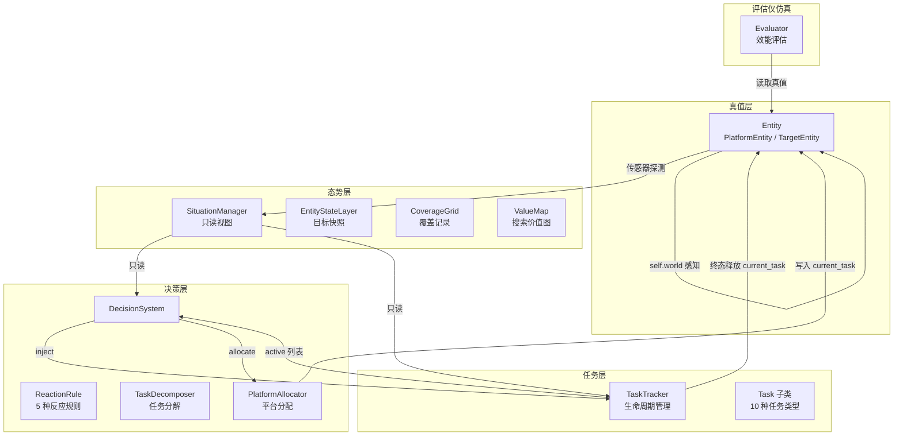

# 异构无人协同指控系统

> Heterogeneous Unmanned Collaborative C2 System — 多场景无人平台协同仿真框架

## 概述

本项目是一个**异构无人集群协同指挥控制仿真系统**，模拟 UAV（无人机）与 UGV（无人车）在多种场景下的协同任务执行。系统采用分层架构设计，将真值层、态势层、任务层、决策层严格解耦，使得仿真逻辑与真实部署的决策代码保持一致。

主要能力包括：

- **多平台协同**：UAV / UGV 异构平台，支持 8 种能力组件（侦察、医疗、充电、拦截、运输、救援、维修、残骸清理）
- **多场景支持**：荒野搜救、边境巡检、区域封控
- **分层架构**：真值层 → 态势层（只读视图）→ 任务层（生命周期管理）→ 决策层（规则 + 分解 + 分配）
- **反应式决策**：基于态势感知自动生成任务（发现目标、低电量充电、拦截侵入者等）
- **任务状态机**：`PENDING → ACTIVE → COMPLETED/FAILED/CANCELLED` 完整生命周期
- **可视化渲染**：Matplotlib 2D 实时可视化（地图、覆盖热力图、平台状态、效能曲线）
- **效能评估**：仿真结束后输出任务完成率、全局目标达成率、综合评分

## 架构概览



## 层职责与约束

| 层 | 允许 | 禁止 |
|---|---|---|
| **Entity**（真值层） | 通过 `self.world` 感知周围；修改自身状态 | 修改其他实体；修改 `task.status` |
| **SituationManager**（态势层） | 接收探测结果注入；维护目标快照和平台引用 | 查询路径中访问 `world.entities` |
| **TaskTracker**（任务层） | 管理 `task.status` 全生命周期；终态释放平台 | 生成任务；分配平台；访问 `world.entities` |
| **DecisionSystem**（决策层） | 评估规则、分解任务、调用分配 | 直接改 `task.status`；访问 `world.entities` |
| **PlatformAllocator**（分配器） | 读写 `platform.current_task`、`task.assigned_platform_ids` | 修改 `task.status` |

> **黄金法则**：`task.status` 的修改**只在 TaskTracker** 中发生。

## 快速开始

### 环境要求

- Python >= 3.10
- Conda（推荐）

### 安装

```bash
# 创建并激活 conda 环境
conda create -n tzb2026 python=3.10
conda activate tzb2026

# 安装依赖
pip install -r requirements.txt
```

### 运行

```bash
# 默认荒野搜救场景
python main.py

# 边境巡检场景
python main.py --scene border

# 区域封控场景
python main.py --scene area

# 带详细日志
python main.py --scene rescue --verbose

# 定时报告（每 300 步）
python main.py --report-interval 300

# 限制最大步数
python main.py --max-steps 1000
```

### 命令行参数

| 参数 | 说明 | 默认值 |
|---|---|---|
| `--scene` | 场景名称：`rescue` / `border` / `area` | `rescue` |
| `--backend` | 渲染后端：`headless` / `matplotlib` | `matplotlib` |
| `--verbose` | 打印每帧详细日志 | `False` |
| `--report-interval` | 定时报告间隔（步） | `0`（不打印） |
| `--max-steps` | 最大仿真步数 | 场景配置值 |

## 项目结构

```
tzb2026/
├── main.py                      # 仿真主入口
├── requirements.txt             # Python 依赖
├── AGENTS.md                    # 编码智能体指南
│
├── entity/                      # 实体模块（真值层）
│   ├── base_entity.py           # 实体基类
│   ├── platform_entity.py       # UAV/UGV 平台实体
│   ├── target_entity.py         # 目标实体（人员/车辆/飞行器/设施）
│   ├── capabilities.py          # 能力组件
│   └── cue_entity.py            # 模糊线索实体
│
├── situation/                   # 态势模块（态势层）
│   ├── situation_manager.py     # 态势管理器（三层态势统一入口）
│   ├── entity_state_layer.py    # 精确实体层（目标快照）
│   ├── coverage_grid.py         # 覆盖记录网格
│   ├── value_map.py             # 搜索价值图
│   └── passability_grid.py      # 可通行图
│
├── task/                        # 任务模块（任务层）
│   ├── tasks.py                 # 10 种任务类型定义
│   └── task_tracker.py          # 任务生命周期管理器
│
├── decision/                    # 决策模块（决策层）
│   ├── decision_system.py       # 决策系统（评估 → 分解 → 分配）
│   ├── rules.py                 # 反应规则
│   ├── platform_allocator.py    # 平台分配器（贪心 + 抢占）
│   └── task_decomposer.py       # 任务分解器
│
├── world/                       # 世界模型模块
│   ├── world.py                 # 仿真驱动器
│   ├── evaluator.py             # 效能评估器
│   ├── matplotlib_renderer.py   # 2D 实时可视化
│   └── backend_bridge.py        # 后端桥接抽象基类
│
├── scene/                       # 场景模块
│   ├── scene_config.py          # 场景配置数据类
│   ├── search_rescue.py         # 荒野搜救场景
│   ├── border_patrol.py         # 边境巡检场景
│   └── area_control.py          # 区域封控场景
│
└── .docs/                       # 设计文档
    ├── 系统与总体架构设计.md
    ├── 实体与能力系统设计.md
    ├── 任务与裁判系统设计.md
    ├── 场景与世界模型设计.md
    ├── 情报与态势系统设计.md
    ├── 指挥与决策系统设计.md
    ├── 场景设计-人员搜救.md
    ├── 场景设计-边境巡检.md
    └── 场景设计-区域封控.md
```

## 场景说明

### 荒野搜救 (`rescue`)

- **地图**：10km × 10km，含障碍物和道路
- **平台**：4 UAV（sensor + medical）+ 2 UGV（charger + cargo + rescue）
- **目标**：5 名伤员（硬编码位置）
- **目标**：救出 >= 4 人
- **时长**：2 小时（仿真时间）

### 边境巡检 (`border`)

- **地图**：12km × 12km，价值图沿边境 Y=0 衰减
- **平台**：4 UAV（sensor + effector）+ 2 UGV（charger + maintenance）
- **目标**：1 名侵入者 + 1 辆车辆 + 1 个设施 + 1 个线索
- **目标**：拦截所有侵入目标，维护设施完好

### 区域封控 (`area`)

- **地图**：6km × 6km，核心区零入侵
- **平台**：5 UAV（sensor + effector）+ 2 UGV（charger + debris_clear）
- **目标**：两波黑飞（T=120s 1 架 + T=900s 3~5 架）
- **目标**：核心区零入侵

## 任务类型

| 优先级 | 任务 | 说明 |
|---|---|---|
| 0 | GuardTask | 区域守卫（永不自动完成） |
| 5 | InterceptTask | 拦截处置 |
| 25 | ChargeTask | 低电量充电 |
| 30 | RescueTask | 人员救援 |
| 40 | MedicalDeliveryTask | 急救包投送 |
| 60 | RepairTask | 设施维修 |
| 60 | ClearTask | 残骸清理 |
| 65 | ArriveTask | 人工引导搜索 |
| 70 | DiscoverTask | 发现目标 |
| 90 | ReconTask | 区域侦察覆盖 |

## 能力组件

| 类型 | 消耗型 | 适用平台 | 用途 |
|---|---|---|---|
| `sensor` | 否 | UAV, UGV | 侦察探测 |
| `medical` | 是 | UAV | 急救包投送 |
| `charger` | 是 | UGV | 为 UAV 换电 |
| `effector` | 是 | UAV | 目标拦截 |
| `cargo` | 装载型 | UGV | 人员/物资运输 |
| `rescue` | 否 | UGV | 人员救援 |
| `maintenance` | 是 | UAV, UGV | 设施维修 |
| `debris_clear` | 否 | UGV | 残骸清理 |

## 反应规则

| 规则 | 触发条件 | 生成任务 |
|---|---|---|
| PersonDiscoveredRule | 新发现 victim | RescueTask + MedicalDeliveryTask（若受伤） |
| HostileTargetRule | 发现 intruder / aerial / vehicle | InterceptTask |
| FacilityAnomalyRule | 发现未修复 facility | RepairTask |
| LowBatteryRule | UAV 电量 < 阈值 | ChargeTask |
| LandingSiteRule | neutralized 未清理 | ClearTask |

## Tick 执行顺序

```
1. _spawn_due_entities()          # 按时间表加入到期实体
2. Bridge.sync_from_backend()     # 后端同步
3. entity.update_control(dt)      # 控制决策
4. entity.update_movement(dt)     # 运动执行
5. entity.update_state(dt)        # 状态逻辑
5.5 SituationManager.sync()       # 态势同步
6. TaskTracker.step()             # 完成判定 → 超时 → 抢占退回
7. DecisionSystem.step()          # 反应规则 → 分解 → 分配
8. render()                       # 渲染
```

## 设计原则

1. **实体自治** — 实体在 `update_state()` 中自主感知并修改自身状态，裁判/决策系统只读不写
2. **态势隔离** — 决策系统和 TaskTracker 通过态势层只读快照查询，不直接接触真值，保证仿真与部署代码一致
3. **TaskTracker 唯一状态机** — 任务状态变更统一由 TaskTracker 执行，其他组件不直接修改 `task.status`
4. **分配器纯匹配** — 分配器只做能力 + 距离匹配，业务判断由 DecisionSystem 处理

## 许可

内部项目，仅供研究使用。
