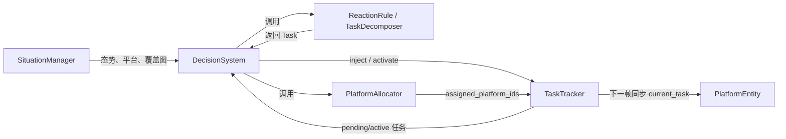

# 决策组开发说明

本目录是异构协同组的主要工作区。小组聚焦“何时生成什么任务、任务由谁执行”，不负责仿真真值、底层运动控制和任务完成裁判。

开始开发前必须先阅读仓库根目录的 `AGENTS.md`，其中的层职责边界优先于本说明。

## 1. V0 范围

- 平台使用现有多旋翼 UAV 和 UGV。
- 固定翼 UAV 和固定传感器实体暂不纳入 V0。
- 固定哨点告警暂由 `CueEntity(source="fixed_sensor")` 表达。
- 优先使用现有 `ReconTask`、`InterceptTask`、`RepairTask`、`ChargeTask`。
- 如果现有任务无法表达需求，可以在 `task/tasks.py` 增加任务类型，但必须同时确认任务完成条件和平台执行行为。
- V0 首先跑通边境巡检闭环，再增加算法对比和其他场景。

## 2. 决策层与其他模块的连接



运行时所有模块位于同一个 Python 进程，通过对象引用、方法参数和返回值传递数据，不在内部模块之间传 JSON。

决策层允许：

- 通过 `SituationManager` 查询已知目标、平台实体和空间态势；
- 通过 `TaskTracker` 读取任务、注入任务和申请激活任务；
- 通过 `PlatformAllocator` 写入 `task.assigned_platform_ids`。

决策层禁止：

- 直接访问 `world.entities`；
- 直接修改 `task.status`；
- 直接修改 `platform.current_task`（由 `TaskTracker` 统一同步）；
- 直接修改目标的 `neutralized`、`repaired` 等真值字段；
- 在分配器中实现目标行为或底层运动控制。

## 3. 组内分工

### A：闭环集成与 Demo

主要文件：

```text
decision/decision_system.py
scene/border_patrol.py
```

职责：

- 串联反应规则、任务分解、平台分配和 TaskTracker；
- 激活满足平台数量要求的任务；
- 维护 `decision_history`，记录分配、抢占和平台不足原因；
- 负责边境巡检端到端运行和验收；
- 协调实体层、态势层和任务层的跨层依赖；
- 后续负责 Demo 输出与基础指标整合。

### B：任务生成与分解

主要文件：

```text
decision/rules.py
decision/task_decomposer.py
task/tasks.py
```

职责：

- 完善边境巡检反应规则；
- 保证同一目标不会重复生成同类任务；
- 根据搜索优先级图和覆盖新鲜度生成或恢复 `ReconTask`；
- 在确有需要时增加任务类型；
- 只生成和返回 Task，不选择平台，不修改任务状态。

对外接口保持为：

```python
triggered = rule.find_triggered(situation, active_tasks)
new_tasks = rule.generate(triggered, situation)

sub_tasks = decomposer.decompose(task, situation, active_tasks)
```

### C：平台分配

主要文件：

```text
decision/platform_allocator.py
```

职责：

- 能力、电量、库存、可达性等硬约束过滤；
- 距离、预计时间、电量、负载和抢占代价的综合评分；
- 高优先级任务对低优先级任务的抢占；
- `ChargeTask` 的 UAV/UGV 双平台分配；
- 返回结构化分配解释；
- 不生成任务，不修改任务状态。

分配器接口冻结为：

```python
decisions = allocator.allocate(
    pending_tasks,
    platform_entities,
    situation,
)
```

每条返回记录固定包含：

```python
{
    "task_id": 5,
    "task_type": "InterceptTask",
    "selected_platform_ids": [2],
    "preempted_task_ids": [0],
    "score": 12.6,
    "reason": "能力匹配且综合代价最低",
}
```

可以增加新的评分分项，但不要删除或改名上述字段。如确需修改接口，先在组内同步，再由 A 修改调用方。

`DecisionSystem` 会将成功分配和未满足平台数量的任务写入 `decision_history`。每条历史记录在上述字段外增加 `time` 和 `outcome`；未分配任务仅在首次出现或分配状态变化时记录，避免 Demo 每帧重复输出。

## 4. 组内运行数据流

```text
B 生成 Task
→ A 注入 TaskTracker
→ A 获取 pending Task
→ C 分配平台、返回 decisions 并写入 assigned_platform_ids
→ A 记录 decision_history，并激活满足平台数量要求的 Task
→ PlatformEntity 下一帧读取 current_task 自主执行
→ TaskTracker 判断完成并释放平台
```

B 和 C 不互相调用，统一由 A 的 `DecisionSystem` 串联。

## 5. 平台与态势查询约定

- 目标状态：`situation.get_entity(entity_id)`，返回 `EntityState` 快照。
- 全部目标：`situation.get_all_targets()`。
- 平台状态快照：`situation.get_platforms()`。
- 可分配平台实体：`situation.get_platform_entities()`。
- 单个平台实体：`situation.get_platform_by_id(platform_id)`。
- 搜索优先级图：`situation.get_search_priority(time, entity_type)`。
- 可通行性：`situation.is_passable(position)`。

越境人员仍使用 `entity_type="person"`，通过 `state.extra["role"] == "intruder"` 识别。

## 6. 添加任务类型时的检查项

新增 Task 子类时至少检查：

1. 在 `task/tasks.py` 定义任务字段、优先级、`required_capabilities` 和完成条件。
2. 在 `rules.py` 或 `task_decomposer.py` 中定义生成时机并做好去重。
3. 确认 `PlatformEntity.update_control()` 能把该任务转换成平台执行意图。
4. 新增完成判定字段时，同步更新 `SituationManager._extract_extra()`。
5. 任务状态仍只能由 TaskTracker 修改。

## 7. 当前基线与已知问题

当前 `PlatformAllocator` 是“能力/电量过滤 + 时间、能耗、通信、负载与抢占代价综合评分 + 贪心分配”的基线实现，C 可在保持接口不变的前提下替换评分逻辑。

以下问题尚未完成，不应被误认为是个人代码引入的回归：

- `ReconTask` 已按覆盖率或搜索优先级恢复比例判定完成，覆盖模型和验收阈值仍需验证；
- 人员和车辆的 effector 处置行为尚未完整闭环；
- 物理线索 `CueEntity(discovered=False)` 的发现与注入仍需完善；
- 边境场景仍使用硬编码 `ArriveTask` 临时引导搜索；
- 低电量规则已使用剩余电量比例；仍需统一规则层与分配器的电量单位、触发阈值和安全保留阈值；
- 最终评估器的边境成功条件仍需收紧。

这些问题涉及任务、实体、态势或评估层，由 A 协调对应模块负责人处理。B、C 不应为绕过问题而破坏层边界。

## 8. 启动检查

在 `code` 目录运行：

```powershell
python main.py --scene border --backend headless --max-steps 100
```

能够正常启动、注入初始任务并完成平台分配，即说明决策层基本接口没有断裂。该检查不代表完整边境任务已经成功。
