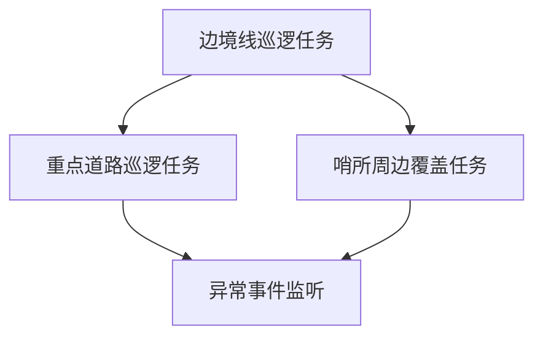
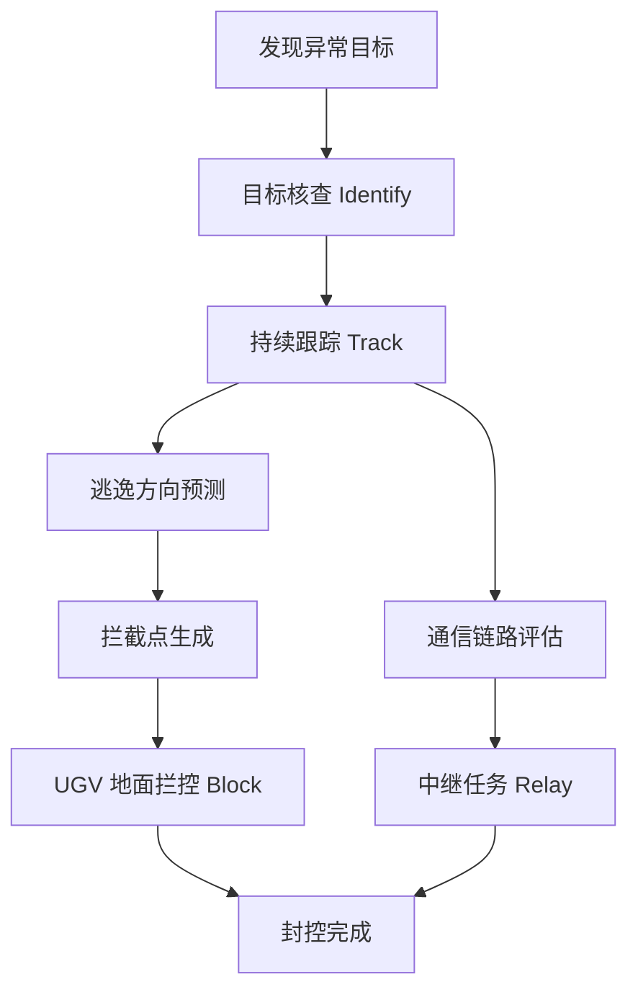

# 异构协同任务规划与任务分配方案

## 1. 模块定位

本方案暂时面向“边境巡检”典型场景，等场景搭建完毕再向其他场景迁移，聚焦异构协同组需要完成的核心闭环：

> 接收态势与任务输入，完成高层任务拆解、平台能力匹配、多目标任务分配、动态重规划和控制指令输出。

异构协同组位于态势层与具身执行层之间，承担“谁去做、做什么、什么时候做、异常后怎么调整”的协同决策职责。

可以概括为：

```text
态势输入 → 任务生成 → 任务图构建 → 能力匹配 → 多目标评分 → 任务分配 → 指令输出 → 执行反馈 → 动态重规划
```

---

## 2. 边境巡检场景设定

### 2.1 场景目标

在山区边境区域内，系统需要对边境线、重点道路、哨所周边和高风险区域进行持续巡检。当固定感知节点或巡逻平台发现异常目标后，系统应快速完成目标核查、持续跟踪、逃逸方向预测、地面拦控和通信保障，实现空地异构平台的协同处置。

### 2.2 典型任务流程

边境巡检任务可以拆解为以下流程：

```text
初始巡逻
  ↓
固定感知节点告警 / UAV 发现异常目标
  ↓
目标核查
  ↓
持续跟踪
  ↓
逃逸方向预测
  ↓
拦截点生成
  ↓
空地协同封控
  ↓
任务完成 / 目标丢失 / 触发重规划
```

### 2.3 可用平台

| 平台类型 | 主要能力 | 适合任务 | 主要限制 |
|---|---|---|---|
| 固定翼 UAV | 速度快、续航长、覆盖范围大 | 边境线巡逻、广域搜索、持续跟踪、通信补盲 | 不能悬停，低速精细核查能力弱 |
| 旋翼 UAV | 可悬停、机动灵活、近距离观测 | 目标核查、近距离跟踪、重点区域搜索 | 续航较短，覆盖范围有限 |
| UGV | 可地面巡逻、封控、补能、中继 | 道路巡查、地面拦截、补能支援、通信中继 | 速度慢，受道路和地形约束 |
| 固定感知节点 | 固定监视、告警触发 | 初始发现、区域警戒、边境线监测 | 不具备机动能力 |

---

## 3. 任务类型设计

边境巡检场景中，建议将任务统一抽象为以下任务类型。

| 任务类型 | 英文标识 | 任务说明 | 推荐平台 |
|---|---|---|---|
| 边境巡逻 | `patrol` | 沿边境线或预设路线巡逻，保持区域覆盖 | 固定翼 UAV、UGV |
| 区域搜索 | `recon` | 对指定区域进行搜索覆盖 | 固定翼 UAV、旋翼 UAV |
| 目标核查 | `identify` | 对异常目标进行近距离确认 | 旋翼 UAV |
| 持续跟踪 | `track` | 持续观测目标位置和运动状态 | 固定翼 UAV、旋翼 UAV |
| 地面拦控 | `block` | 前往预测拦截点，限制目标通过 | UGV |
| 通信中继 | `relay` | 移动到中继位置，保障链路连通 | 固定翼 UAV、UGV |
| 补能支援 | `charge` | 为低电量平台提供补能或引导返航 | UGV |
| 返航待命 | `return` | 电量不足或任务结束后返回基地 | UAV、UGV |
| 动态重规划 | `replan` | 因目标逃逸、电量不足、目标丢失等事件重新分配任务 | 决策系统 |

---

## 4. 任务图规划

### 4.1 初始巡逻任务图

系统初始化时，生成基础巡逻任务：



初始任务可表示为（暂时想到边境线巡逻，重点道路巡逻，哨所区域侦察）：

```python
initial_tasks = [
    {
        "task_id": "T_patrol_border_01",
        "task_type": "patrol",
        "area": "border_line",
        "priority": 3,
        "required_capability": ["wide_area_recon"],
        "required_platform_num": 1,
        "status": "pending"
    },
    {
        "task_id": "T_patrol_road_01",
        "task_type": "patrol",
        "area": "key_road",
        "priority": 4,
        "required_capability": ["ground_patrol"],
        "required_platform_num": 1,
        "status": "pending"
    },
    {
        "task_id": "T_recon_outpost_01",
        "task_type": "recon",
        "area": "outpost_area",
        "priority": 4,
        "required_capability": ["sensor"],
        "required_platform_num": 1,
        "status": "pending"
    }
]
```

### 4.2 异常目标处置任务图

当固定感知节点或 UAV 发现越界目标后，系统自动插入新的任务链：



事件触发后生成的任务可表示为：

```python
event_tasks = [
    {
        "task_id": "T_identify_intruder_01",
        "task_type": "identify",
        "target_id": "intruder_01",
        "priority": 1,
        "required_capability": ["identify", "sensor"],
        "required_platform_num": 1,
        "predecessors": [],
        "deadline": 120,
        "status": "pending"
    },
    {
        "task_id": "T_track_intruder_01",
        "task_type": "track",
        "target_id": "intruder_01",
        "priority": 1,
        "required_capability": ["track", "sensor"],
        "required_platform_num": 1,
        "predecessors": ["T_identify_intruder_01"],
        "deadline": 300,
        "status": "pending"
    },
    {
        "task_id": "T_block_intruder_01",
        "task_type": "block",
        "target_id": "intruder_01",
        "priority": 2,
        "required_capability": ["block", "ground_mobility"],
        "required_platform_num": 1,
        "predecessors": ["T_track_intruder_01"],
        "deadline": 360,
        "status": "pending"
    },
    {
        "task_id": "T_relay_intruder_01",
        "task_type": "relay",
        "target_id": "intruder_01",
        "priority": 2,
        "required_capability": ["relay"],
        "required_platform_num": 1,
        "predecessors": [],
        "deadline": 240,
        "status": "pending"
    }
]
```

---

## 5. 平台能力建模

平台能力应采用结构化数据表达，方便算法直接调用。

```python
platforms = [
    {
        "platform_id": "FW_UAV_1",
        "type": "fixed_wing_uav",
        "position": [1.0, 2.0],
        "speed": 35.0,
        "battery": 45.0,
        "status": "idle",
        "current_task": None,
        "capabilities": [
            "wide_area_recon",
            "track",
            "relay"
        ]
    },
    {
        "platform_id": "MR_UAV_1",
        "type": "rotor_uav",
        "position": [2.0, 3.0],
        "speed": 18.0,
        "battery": 24.0,
        "status": "idle",
        "current_task": None,
        "capabilities": [
            "sensor",
            "identify",
            "track"
        ]
    },
    {
        "platform_id": "MR_UAV_2",
        "type": "rotor_uav",
        "position": [3.0, 2.0],
        "speed": 18.0,
        "battery": 20.0,
        "status": "idle",
        "current_task": None,
        "capabilities": [
            "sensor",
            "identify",
            "track"
        ]
    },
    {
        "platform_id": "UGV_1",
        "type": "ugv",
        "position": [0.5, 1.0],
        "speed": 8.0,
        "battery": 60.0,
        "status": "idle",
        "current_task": None,
        "capabilities": [
            "ground_patrol",
            "block",
            "charge"
        ]
    },
    {
        "platform_id": "UGV_2",
        "type": "ugv",
        "position": [1.0, 1.0],
        "speed": 7.0,
        "battery": 65.0,
        "status": "idle",
        "current_task": None,
        "capabilities": [
            "ground_patrol",
            "relay",
            "charge"
        ]
    }
]
```

---

## 6. 任务分配原则

任务分配应综合能力、时间、电量、风险、通信、任务收益和当前负载。

### 6.1 硬约束过滤

平台执行任务前，先判断是否满足硬约束：

```text
1. 能力约束：平台能力必须覆盖任务需求能力。
2. 能量约束：平台剩余电量必须支持执行任务并保留安全返航余量。
3. 时间约束：平台预计到达时间和执行时间不能超过任务截止时间。
4. 状态约束：故障、离线、人工接管平台不能参与自动分配。
5. 地形约束：UGV 只能在可通行道路或地形上执行任务。
6. 依赖约束：存在前序任务时，必须等待前序任务完成或达到可并行条件。
```

### 6.2 多目标评分函数

平台 \(j\) 执行任务 \(i\) 的综合代价定义为：

$$
C_{ij}
= w_t T_{ij}
+ w_e E_{ij}
+ w_r R_{ij}
+ w_c C^{comm}_{ij}
+ w_l L_j
$$

其中：

| 符号 | 含义 |
|---|---|
| \(T_{ij}\) | 平台 \(j\) 执行任务 \(i\) 的预计耗时 |
| \(E_{ij}\) | 平台 \(j\) 执行任务 \(i\) 的预计能耗 |
| \(R_{ij}\) | 平台执行任务路径或区域风险 |
| \(C^{comm}_{ij}\) | 通信质量惩罚项 |
| \(L_j\) | 平台当前负载 |
| \(w_t,w_e,w_r,w_c,w_l\) | 各项权重 |

总体目标为：

$$
\min_{x_{ij}} J
= \sum_{i \in \mathcal{T}} \sum_{j \in \mathcal{P}} x_{ij} C_{ij}
+ \lambda_1 T_{finish}
+ \lambda_2 N_{fail}
+ \lambda_3 N_{replan}
$$

其中：

| 符号 | 含义 |
|---|---|
| \(x_{ij}\) | 若平台 \(j\) 被分配给任务 \(i\)，则为 1，否则为 0 |
| \(T_{finish}\) | 全局任务完成时间 |
| \(N_{fail}\) | 失败任务数量 |
| \(N_{replan}\) | 重规划次数 |
| \(\lambda_1,\lambda_2,\lambda_3\) | 全局惩罚项权重 |

约束条件包括：

### 约束条件

| 公式                                    | 约束含义     | 对应实际问题                   |
| --------------------------------------- | ------------ | ------------------------------ |
| (\sum_j x_{ij} \geq n_i)                | 平台数量约束 | 每个任务至少要有人干           |
| (x_{ij}=0) if (Cap_j \not\supset Req_i) | 能力匹配约束 | 不能让不具备能力的平台执行任务 |
| (E_{ij}+E^{return}_{j} \leq B_j)        | 电量约束     | 不能派电量不够的平台           |
| (t_i^{start}+T_{ij}+D_i \leq d_i)       | 截止时间约束 | 必须按时完成任务               |
| (t_k^{start} \geq t_i^{finish})         | 任务依赖约束 | 后续任务必须等前置任务完成     |

任务所需平台数量约束：

$$
\sum_{j \in P} x_{ij} \ge n_i,\quad \forall i \in T
$$

能力匹配约束：

$$
x_{ij}=0,\quad \mathrm{if}\ \mathrm{Req}_i \not\subseteq \mathrm{Cap}_j
$$

能源约束：

$$
E_{ij}+E^{return}_{j} \le B_j
$$

时间约束：

$$
t_i^{start}+T_{ij}+D_i \le d_i
$$

任务依赖约束：

$$
t_k^{start} \ge t_i^{finish},\quad \forall (i,k) \in E
$$

---

## 7. 任务分配流程

可以先简单采用“能力过滤 + 加权评分 + 贪心分配”的可解释方法。

```text
Step 1：读取当前态势、任务队列、平台状态。
Step 2：按照任务优先级和任务依赖关系排序。
Step 3：对每个任务进行平台能力过滤。
Step 4：计算候选平台的综合代价 C_ij。
Step 5：选择代价最低的平台或平台组合。
Step 6：更新平台占用状态和任务分配映射。
Step 7：生成高层控制指令。
Step 8：记录分配原因和决策指标。
```

---

## 8. 边境巡检示例分配

### 8.1 初始巡逻阶段

初始状态下，系统需要完成边境线巡逻、重点道路巡逻和哨所区域覆盖。

| 任务 | 推荐分配平台 | 分配原因 |
|---|---|---|
| 边境线巡逻 `T_patrol_border_01` | `FW_UAV_1` | 固定翼 UAV 速度快、续航长，适合大范围边境线巡逻 |
| 重点道路巡逻 `T_patrol_road_01` | `UGV_1` | UGV 适合道路巡逻和地面接近 |
| 哨所周边覆盖 `T_recon_outpost_01` | `MR_UAV_1` | 旋翼 UAV 可悬停，适合小范围重点区域覆盖 |
| 备份与中继待命 | `UGV_2` | 保持机动余量，用于后续通信中继或补能支援 |
| 机动备份 | `MR_UAV_2` | 保持空中快速响应能力，用于异常目标核查或接替跟踪 |

对应输出：

```python
initial_assignments = [
    {
        "task_id": "T_patrol_border_01",
        "platform_ids": ["FW_UAV_1"],
        "reason": "fixed-wing UAV has long endurance and wide-area recon capability"
    },
    {
        "task_id": "T_patrol_road_01",
        "platform_ids": ["UGV_1"],
        "reason": "UGV is suitable for road patrol and ground mobility"
    },
    {
        "task_id": "T_recon_outpost_01",
        "platform_ids": ["MR_UAV_1"],
        "reason": "rotor UAV is suitable for hovering and close-area observation"
    }
]
```

### 8.2 异常目标出现阶段

假设固定感知节点在边境线附近发现异常目标 `intruder_01`，位置为 `[8.5, 6.0]`，系统生成目标核查、持续跟踪、地面拦控和通信中继任务。

| 新任务 | 推荐分配平台 | 分配原因 |
|---|---|---|
| 目标核查 `T_identify_intruder_01` | `MR_UAV_2` | 旋翼 UAV 可快速抵近并悬停观察，且当前空闲 |
| 持续跟踪 `T_track_intruder_01` | `FW_UAV_1` | 固定翼 UAV 已在边境线巡逻，具备广域跟踪能力 |
| 地面拦控 `T_block_intruder_01` | `UGV_1` | UGV 已在重点道路巡逻，适合前往预测拦截点 |
| 通信中继 `T_relay_intruder_01` | `UGV_2` | UGV_2 具备中继能力，且当前未承担主任务 |

对应输出：

```python
event_assignments = [
    {
        "task_id": "T_identify_intruder_01",
        "platform_ids": ["MR_UAV_2"],
        "reason": "MR_UAV_2 is idle and has identify capability with sufficient battery"
    },
    {
        "task_id": "T_track_intruder_01",
        "platform_ids": ["FW_UAV_1"],
        "reason": "FW_UAV_1 has long endurance and wide-area tracking capability"
    },
    {
        "task_id": "T_block_intruder_01",
        "platform_ids": ["UGV_1"],
        "reason": "UGV_1 has block capability and is close to the key road"
    },
    {
        "task_id": "T_relay_intruder_01",
        "platform_ids": ["UGV_2"],
        "reason": "UGV_2 has relay capability and can improve communication coverage"
    }
]
```

对应控制指令：

```python
commands = [
    {
        "platform_id": "MR_UAV_2",
        "command_type": "move_to",
        "target_pos": [8.5, 6.0],
        "task_id": "T_identify_intruder_01"
    },
    {
        "platform_id": "FW_UAV_1",
        "command_type": "track",
        "target_id": "intruder_01",
        "task_id": "T_track_intruder_01"
    },
    {
        "platform_id": "UGV_1",
        "command_type": "move_to",
        "target_pos": [9.0, 4.5],
        "task_id": "T_block_intruder_01"
    },
    {
        "platform_id": "UGV_2",
        "command_type": "move_to",
        "target_pos": [6.5, 5.0],
        "task_id": "T_relay_intruder_01"
    }
]
```

---

## 9. 动态重规划设计

动态重规划是体现“智慧化水平”的关键。第一版可以只支持 3 类事件。

### 9.1 事件一：发现新目标

触发条件：

```text
固定感知节点或 UAV 探测到新的越界目标。
```

处理逻辑：

```text
1. 生成 identify、track、block、relay 任务。
2. 插入当前任务图。
3. 提升新目标相关任务优先级。
4. 对受影响平台进行局部重分配。
5. 输出新控制指令。
```

### 9.2 事件二：旋翼 UAV 电量不足

触发条件：

```text
MR_UAV_2 电量低于安全阈值，例如 battery < 15%。
```

处理逻辑：

```text
1. 释放 MR_UAV_2 当前核查或跟踪任务。
2. 为 MR_UAV_2 生成 return 或 charge 任务。
3. 查找可接替平台。
4. 若 MR_UAV_1 可用，则接替 identify / track 任务。
5. 若无可接替平台，则由 FW_UAV_1 保持远距离持续跟踪。
```

重规划输出示例：

```python
replan_result_battery_low = {
    "trigger": "battery_low",
    "affected_platform": "MR_UAV_2",
    "released_task": "T_identify_intruder_01",
    "new_assignments": [
        {
            "task_id": "T_return_MR_UAV_2",
            "platform_ids": ["MR_UAV_2"],
            "reason": "battery below safety threshold"
        },
        {
            "task_id": "T_identify_intruder_01",
            "platform_ids": ["MR_UAV_1"],
            "reason": "MR_UAV_1 has identify capability and enough battery to take over"
        }
    ]
}
```

### 9.3 事件三：目标改变逃逸方向

触发条件：

```text
目标速度方向发生明显变化，原拦截点失效。
```

处理逻辑：

```text
1. 根据目标当前位置和速度重新预测逃逸路线。
2. 生成新的拦截点。
3. 判断当前 UGV 是否还能按时到达。
4. 若不能按时到达，则重新选择 UGV 或调整 UAV 跟踪策略。
5. 更新 block 任务目标点并输出新指令。
```

重规划输出示例：

```python
replan_result_escape = {
    "trigger": "target_escape_direction_changed",
    "target_id": "intruder_01",
    "old_block_point": [9.0, 4.5],
    "new_block_point": [7.5, 3.8],
    "new_assignments": [
        {
            "task_id": "T_block_intruder_01",
            "platform_ids": ["UGV_1"],
            "reason": "UGV_1 can still arrive at the updated block point before deadline"
        }
    ],
    "new_commands": [
        {
            "platform_id": "UGV_1",
            "command_type": "move_to",
            "target_pos": [7.5, 3.8],
            "task_id": "T_block_intruder_01"
        }
    ]
}
```

---

## 10. 决策输出接口

异构协同模块最终应输出统一格式，供 UE、具身执行层和前端展示调用。

```python
decision_output = {
    "time": 120.0,
    "assignments": [
        {
            "task_id": "T_identify_intruder_01",
            "platform_ids": ["MR_UAV_2"],
            "reason": "MR_UAV_2 is idle and has identify capability with sufficient battery"
        },
        {
            "task_id": "T_track_intruder_01",
            "platform_ids": ["FW_UAV_1"],
            "reason": "FW_UAV_1 has long endurance and wide-area tracking capability"
        }
    ],
    "commands": [
        {
            "platform_id": "MR_UAV_2",
            "command_type": "move_to",
            "target_pos": [8.5, 6.0],
            "task_id": "T_identify_intruder_01"
        },
        {
            "platform_id": "FW_UAV_1",
            "command_type": "track",
            "target_id": "intruder_01",
            "task_id": "T_track_intruder_01"
        }
    ],
    "decision_log": [
        {
            "task_id": "T_identify_intruder_01",
            "selected_platform": "MR_UAV_2",
            "candidate_platforms": ["MR_UAV_1", "MR_UAV_2"],
            "reason": "MR_UAV_2 is selected due to idle status, sufficient battery, and lower estimated arrival time"
        }
    ],
    "metrics": {
        "planning_time": 0.035,
        "assigned_task_num": 4,
        "unassigned_task_num": 0,
        "replan_count": 1,
        "average_response_time": 18.5,
        "estimated_energy_cost": 34.2
    }
}
```

---

## 11. 闭环展示脚本

为了尽快形成 Demo，建议第一版只展示以下 4 个阶段。

### 阶段一：初始巡逻

展示内容：

```text
系统读取平台状态和巡逻任务。
FW_UAV_1 执行边境线巡逻。
UGV_1 执行重点道路巡逻。
MR_UAV_1 执行哨所周边覆盖。
UGV_2 和 MR_UAV_2 保持待命。
```

体现能力：

```text
统一平台建模、统一任务管理、初始任务分配。
```

### 阶段二：发现异常目标

展示内容：

```text
固定感知节点触发告警。
系统自动生成 identify、track、block、relay 子任务。
系统完成空地异构平台分配。
```

体现能力：

```text
任务自动拆解、异构能力匹配、多平台协同响应。
```

### 阶段三：协同处置

展示内容：

```text
MR_UAV_2 前往目标位置核查。
FW_UAV_1 进行持续跟踪。
UGV_1 前往预测拦截点。
UGV_2 前往中继位置保障通信。
```

体现能力：

```text
空地协同、任务并行、资源协同。
```

### 阶段四：动态重规划

展示内容：

```text
目标改变逃逸方向，原拦截点失效。
系统重新预测拦截点。
UGV_1 调整行进目标。
MR_UAV_1 或 MR_UAV_2 根据电量状态接替核查或跟踪任务。
```

体现能力：

```text
临机调整、动态封控、任务接替、重规划解释。
```

